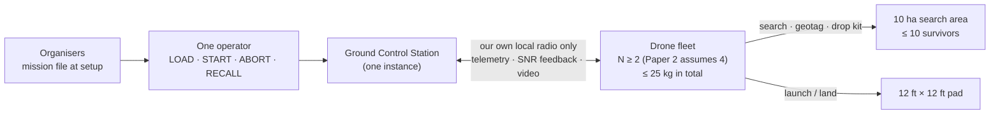
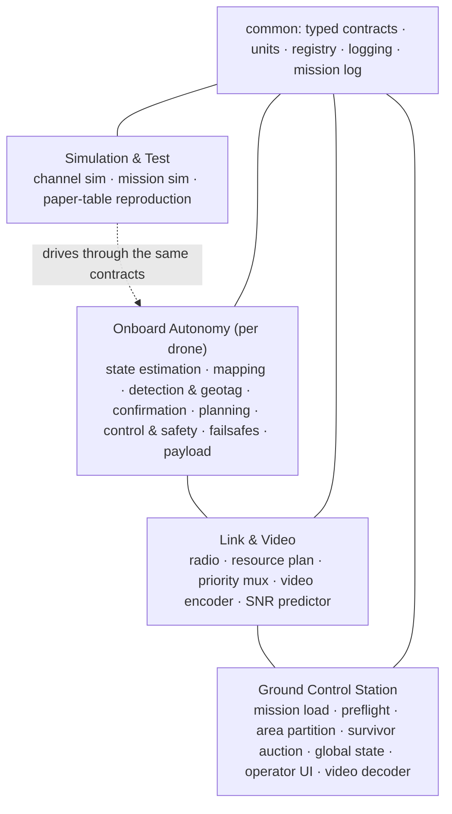
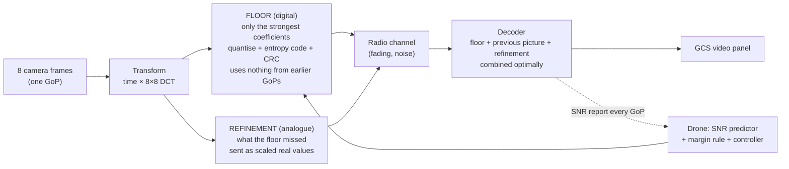

# Nidder — NIDAR RescueSwarm Video Transmission & System Architecture

**Team RescueSwarm · NIDAR 2.0 · Track 1 (Drone Innovation)**

This repository holds:
- the **architecture** of our collaborative multi-drone search-and-rescue system;
- a **working software implementation** (in simulation) of its **live-video transmission link**;
- the **mission logic** (area division, survivor confirmation, survivor auction, coverage, failsafes) running in a **multi-drone mission simulator**.

Every design decision is traced to one of three source documents:
- the **Mission Brief** (the competition rules);
- **Paper 1**, on video transmission;
- **Paper 2**, on the swarm / mission model.

Every claim is labelled with how strong its evidence is.

> **Status in one sentence.** The architecture is fully documented. The video link and the mission logic are built and tested **in simulation**. Flight control, perception and the ground-station screens are **designed but not yet implemented**, and they wait on hardware and team decisions listed in [docs/OPEN_QUESTIONS.md](docs/OPEN_QUESTIONS.md).

---

## Contents

1. [The mission in 60 seconds](#1-the-mission-in-60-seconds)
2. [What is in this repository, and what is not](#2-what-is-in-this-repository-and-what-is-not)
3. [Status at a glance](#3-status-at-a-glance)
4. [Quick start: run it in 5 minutes](#4-quick-start-run-it-in-5-minutes)
5. [How to read the architecture, step by step](#5-how-to-read-the-architecture-step-by-step)
6. [The system architecture explained](#6-the-system-architecture-explained)
7. [The video transmission link explained](#7-the-video-transmission-link-explained)
8. [What we verified, and what we found](#8-what-we-verified-and-what-we-found)
9. [Code tour: every folder and what it does](#9-code-tour-every-folder-and-what-it-does)
10. [Running things: tests, demos, tools](#10-running-things-tests-demos-tools)
11. [How we keep it honest: tags, evidence levels, traceability](#11-how-we-keep-it-honest-tags-evidence-levels-traceability)
12. [Decisions the team still has to make](#12-decisions-the-team-still-has-to-make)
13. [Roadmap](#13-roadmap)
14. [How to contribute](#14-how-to-contribute)
15. [Sources, licences and credits](#15-sources-licences-and-credits)
16. [Glossary](#16-glossary)

---

## 1. The mission in 60 seconds

**The scenario** (from the [Mission Brief](docs/sources/mission_brief.pdf)): a flash flood has hit a semi-urban area. Roads are blocked, telecom is down, and up to **10 survivors** are somewhere in a **10-hectare** area.

**What our system must do:**
- Search the area with **2 or more autonomous drones** working as **one coordinated system**.
- **Detect and geotag** survivors.
- **Drop a 200 g survivor kit** (a 20 × 10 × 5 cm box) near each one.
- Land back on a **12 ft × 12 ft pad**, all within **30 minutes of flight time**.

**The hard rules:**

| Rule | Detail |
|---|---|
| Weight | All drones together weigh **≤ 25 kg** |
| Setup | **5 minutes**, at most 2 people |
| Operator | **Exactly one**, at **one** Ground Control Station (GCS) |
| Operator inputs | Only four actions: **load mission file, start mission, safety abort, emergency recall**. Anything else counts as manual intervention |
| Network | **No external network**: no GSM / LTE / Wi-Fi / internet / cloud, no tethers. Everything runs over our own local radio |
| Failsafes | Every drone needs: return-to-home, low battery, command-link loss, geofence breach, abort, recall |

**The GCS must show:**
- the loaded mission boundary
- the live position and status of every drone
- the tagged survivors
- kit delivery status per drone
- mission progress
- a **live video feed**

**How the two papers fit in:**
- **Paper 2** designs the mission system: state estimation, area partitioning, the survivor auction, trajectory control, safety barriers and failsafes.
- **Paper 1** designs a robust **video transmission** method for that live feed.
  - A digital **"floor"** guarantees minimum quality with a stated probability.
  - An analogue **"refinement"** adds quality when the radio channel is good.

---

## 2. What is in this repository, and what is not

### ✅ In the repository

| Area | Contents |
|---|---|
| **Architecture docs** (`docs/`) | System design, the video subsystem, typed interfaces, the traceability matrix, risk register, open questions and pending ideas, repository layout |
| **Source documents** (`docs/sources/`) | The Mission Brief, Paper 1 and Paper 2, as PDFs |
| **Python package** (`nidar/`) | Typed contracts for every message, a component registry, logging, a mission log, the **complete video transmission pipeline**, and the **swarm / GCS mission logic** |
| **Simulators** (`sim/`) | Radio channel (fading and delayed feedback), end-to-end video link, test-video generators, an H.264 comparison baseline, the paper's synthetic experiment, and a **multi-drone mission simulator** with 10 scenarios |
| **Tests** (`tests/`) | 530 fast tests plus 10 slow ones, including reproduction of the paper's published tables and a **traceability gate** that fails if any requirement lacks a module or a test |
| **Tools** (`tools/`) | Quality gate runner, video demo, mission runner, and the certified floor-design builder |

### ❌ Not in the repository yet

| Area | Why not |
|---|---|
| Flight control (NMPC, collision barriers), state estimation, terrain mapping, the survivor detector | Designed (docs + typed interfaces + stubs) but **not implemented**. They need hardware choices (sensors, compute) and the go-ahead for the onboard phase |
| Most of the GCS user interface | No UI toolkit chosen yet (OQ-35). The **logic** behind the four operator buttons and the video service exist |
| Real radio / SDR driver | No radio hardware chosen yet (OQ-03, OQ-10) |
| Real floor channel code (LDPC or rateless) | Code family not chosen (OQ-23). Simulation uses an ideal stand-in |
| Real drone footage, the detector's training data | The dataset lives in the team's separate `NIDAR` repository; no flight footage exists yet |

> **Stubs are explicit.** Every not-yet-built function raises `NotYetImplemented`. That error names the paper equation it will implement and what it is waiting for, so a stub can never be mistaken for a working result.

---

## 3. Status at a glance

Legend:
- ✅ done and tested
- 🟡 done in simulation / with stand-ins
- 📐 designed only (docs + interfaces + stubs)
- ⛔ blocked on a team decision

| Part | Status | Where | Notes |
|---|---|---|---|
| Architecture & requirements traceability | ✅ | [docs/](docs/) | 63 requirements traced to source, module, test and evidence level |
| Typed contracts, registry, logging, mission log | ✅ | `nidar/common/` | Self-validating messages; registry fails loudly on unknown names |
| GCS operator gate (only the 4 Brief actions) | ✅ | `nidar/gcs/controllers/operator_actions.py` | Enabled per mission phase |
| **Paper 1 maths & certificates** | ✅ | `nidar/video/certificates/`, `floor/`, `refinement/`, `control/` | 29 published numbers reproduced; 2 small and 2 real mismatches reported |
| **Paper 1 video pipeline (encoder/decoder)** | 🟡 | `nidar/video/` | Works end to end in simulation; Python is not real time |
| Radio channel simulator | ✅ | `sim/channel/` | Rayleigh block fading, delayed noisy SNR reports |
| End-to-end video simulation + H.264 baseline | ✅ | `sim/video/` | Uses the local ffmpeg for H.264 |
| GCS video service (data side of the video panel) | ✅ | `nidar/gcs/services/video_service.py` | On-screen widget ⛔ OQ-35 |
| Floor channel code | 🟡 | `nidar/video/floor/code.py` | Ideal-outage stand-in; real code ⛔ OQ-23 |
| Radio driver | 🟡 | `nidar/link/radio.py` | In-memory loopback only; hardware ⛔ OQ-03/10 |
| Onboard autonomy (estimation, mapping, perception, flight control) | 📐 | `nidar/onboard/` | Stubs citing Paper 2 equations; payload maths and coverage planning are implemented |
| Swarm logic (area partition, auction, confirmation, coverage) | 🟡 | `nidar/swarm/`, `nidar/onboard/planning/` | Implemented and tested; Paper 2's conflicting formulas are all selectable settings |
| Failsafe guards (low battery, link loss, abort, recall) | 🟡 | `nidar/onboard/automaton/guards.py` | Tested in the mission simulator; full mode table still ⛔ OQ-05a |
| GCS mission logic (GeoJSON loader, preflight gates, global state, partition and auction services) | ✅ | `nidar/gcs/` | Screens ⛔ OQ-35 |
| **Mission simulator** | 🟡 | `sim/mission/`, `sim/scenarios/` | Kinematic (points, no flight dynamics); 10 scenarios |

Test IDs: **65 of 95** planned tests are implemented. The rest belong to the not-yet-started phases ([tests/test_index.json](tests/test_index.json)).

---

## 4. Quick start: run it in 5 minutes

**You need:** Python **3.11** and git. ffmpeg is optional; it is only needed for the H.264 comparison.

The repository is **private**. Ask the owner to add you under *Settings → Collaborators*.

**Step 1 — clone**
```bash
git clone https://github.com/suvronilchatterjee7-create/Nidder-video-transmission.git
```
```bash
cd Nidder-video-transmission
```

**Step 2 — create a virtual environment (Python 3.11) and install the pinned tools**
```bash
python -m venv .venv
```
Windows:
```bash
.venv\Scripts\python -m pip install -r requirements-dev.txt
```
macOS / Linux:
```bash
.venv/bin/python -m pip install -r requirements-dev.txt
```

**Step 3 — run every quality gate** (lint + 530 tests + traceability, about 75 s)
```bash
.venv\Scripts\python tools\check.py
```
You should see `All gates passed.` Two tests are reported as `xfailed`. That is intended: they record numbers from the paper that we could **not** reproduce (see §8).

**Step 4 — watch the video link work** (synthetic video through a simulated radio, about 6 s)
```bash
.venv\Scripts\python tools\demo_video_link.py
```
Example output:
```
PAPER PILOT PROFILE (simulation, not our link) | 176x320, 25 fps, G=8 | video=synthetic | AWGN | motion=zero
SNR dB  floors   PSNR floor-only  model Teq Mbps-eq floor share
   4.0   3/3    36.44      34.95  36.53        3.58       0.683
   8.0   3/3    38.40      34.95  38.64        6.20       0.430
  12.0   3/3    39.77      34.95  40.10        8.45       0.302
```

How to read the table:
- **PSNR** is the received quality.
- **Floor-only** is the guaranteed part.
- **Model** is what the paper's equations predict.
- **Teq** is the paper's "rate-distortion-equivalent throughput" (the floor guarantees ≥ 2 Mbps-eq).
- **Floor share** is the fraction of radio resources the floor uses.

Variants to try:
```bash
.venv\Scripts\python tools\demo_video_link.py --h264
```
```bash
.venv\Scripts\python tools\demo_video_link.py --fading 8
```
```bash
.venv\Scripts\python tools\demo_video_link.py --size 288x352 --snr 2 6 10 --gops 4
```

**Step 5 — run simulated missions** (10 scenarios, about 13 s)
```bash
.venv\Scripts\python tools\run_mission.py
```
Each line is one complete mission: area searched, survivors tagged, kits delivered, landing, closest approach between drones. To see what happened, second by second:
```bash
.venv\Scripts\python tools\run_mission.py sim\scenarios\link_loss.json --timeline
```

**Step 6 (optional) — the slow reproductions** (certified floor search and the paper's synthetic experiment, about 3 min more)
```bash
.venv\Scripts\python tools\check.py --full
```

---

## 5. How to read the architecture, step by step

Read the documents in this order. Each step says what you will learn and roughly how long it takes.

| Step | Document | What you learn | Time |
|---|---|---|---|
| 1 | **This README** | The mission, what exists, how to run it | 20 min |
| 2 | [docs/ARCHITECTURE.md](docs/ARCHITECTURE.md) | The whole system: actors, the 4 runtime layers, components, deployment, and **sequence diagrams** for setup, search, detect → deliver → return, video, and every failsafe; budgets; language choices; what is proved vs targeted | 45 min |
| 3 | [docs/VIDEO_SUBSYSTEM.md](docs/VIDEO_SUBSYSTEM.md) | Paper 1 turned into 14 modules with the exact equations, its hard prerequisites, how video shares the radio with telemetry, the parameter register, the verification plan | 60 min |
| 4 | [docs/INTERFACES.md](docs/INTERFACES.md) | Every message between modules as a typed Python contract (mission file, drone state, detections, survivors, auction, link, video, GCS display) | 30 min |
| 5 | [docs/TRACEABILITY.md](docs/TRACEABILITY.md) | Every requirement (Brief, Paper 1, Paper 2) → source section → code module → test → evidence level | 20 min |
| 6 | [docs/REPRODUCTION_P1.md](docs/REPRODUCTION_P1.md) | Which of Paper 1's published numbers our code reproduces, and which it does not | 15 min |
| 7 | [docs/VIDEO_PIPELINE.md](docs/VIDEO_PIPELINE.md) | The built video link: design choices, end-to-end results, latency, **comparison with H.264** | 20 min |
| 7b | [docs/MISSION_SIM.md](docs/MISSION_SIM.md) | The mission logic and simulator: what is built, scenario results, **findings on kits, separation and decoys** | 15 min |
| 8 | [docs/OPEN_QUESTIONS.md](docs/OPEN_QUESTIONS.md) | 35 decisions the sources leave open, or where they contradict each other | 30 min |
| 9 | [docs/RISK_REGISTER.md](docs/RISK_REGISTER.md) · [docs/IDEAS_PENDING.md](docs/IDEAS_PENDING.md) | What could sink us; ideas not adopted yet | 15 min |
| 10 | [docs/REPO_LAYOUT.md](docs/REPO_LAYOUT.md) | The code tree and phase-by-phase status | 10 min |

All diagrams are written in Mermaid, so GitHub draws them directly in the browser.

---

## 6. The system architecture explained

### 6.1 Who talks to whom



**Rules that shape everything:**
- **Operator:** can do only four things, and the code makes sure no other input path exists.
- **Network:** nothing may rely on the internet. A static test checks that no network library is imported anywhere in the runtime code.

### 6.2 Four layers plus a shared core



| Layer | What it owns | Key rule |
|---|---|---|
| **Onboard Autonomy** | Everything a drone needs to fly the mission alone | Every failsafe must work even with the radio link down |
| **Link & Video** | Radio access, how each video interval's radio resources are split, telemetry framing, the video encoder | Makes no mission decisions |
| **GCS** | Mission file, preflight checks, area partition, survivor auction, display, video decoder | Offers the operator nothing beyond the 4 permitted actions |
| **Simulation & Test** | Simulators and reproductions | Runtime code may never import it (tested) |

### 6.3 One mission, end to end

1. **Setup (≤ 5 min):** boot → load the mission file → split the area between drones → self-test → estimator check → **START**. Paper 2 gives a minute-by-minute plan.
2. **Search:** each drone sweeps its own area in a lawn-mower pattern. The GCS keeps re-balancing the areas using battery level and status (*Dynamic Weighted Voronoi Tessellation*).
3. **Detect → confirm → geotag:**
   - The camera detector finds a person.
   - A ray is cast into the 3-D terrain map to get a geotag with an uncertainty ellipse.
   - A Bayesian check needs about 10 consistent frames and > 95 % belief before the survivor is "confirmed".
4. **Auction:** the GCS assigns the confirmed survivor to the best drone (Hungarian algorithm), weighing distance, battery, kit on board and abandoned search area.
5. **Deliver:** precise final approach, then the kit is released. The controller compensates instantly for the 200 g mass drop.
6. **Return:** land inside the pad with zero velocity.
7. **Failsafes at any time:** low battery or link loss → return home; geofence → barrier constraint; operator abort or recall → broadcast to all drones. All of these are drawn as sequence diagrams in [ARCHITECTURE.md §6](docs/ARCHITECTURE.md#6-key-flows-and-sequences).

**Implementation status:** steps 1–7 are **designed, not implemented**. Only the operator gate and the typed messages exist in code.

---

## 7. The video transmission link explained

This is the part that is built and runnable.

### 7.1 The problem

The GCS must show live video over our own radio. Radio quality changes all the time, and a normal codec (H.264/H.265) picks its bit rate *before* it knows the channel:
- When the channel drops below that rate, the picture **breaks up** (the "cliff").
- When the channel is better, the extra capacity is **wasted**.

Paper 1 wants instead:
- a **guaranteed minimum quality** (≥ 2 Mbps-equivalent) in every group of frames, with a stated probability;
- **more quality** automatically when the channel is good (up to 10 Mbps-equivalent).

### 7.2 The idea: a guaranteed floor plus a free-riding refinement

Video is processed in **GoPs** (groups of pictures: 8 frames, about 0.3 s). Each GoP is sent as two layers.



- **Floor (digital):**
  - It is sized so that, if it arrives, quality is **at least** the 2 Mbps-equivalent target. That is a theorem (Prop. 7 / Thm 2).
  - It is protected by a long channel code whose failure probability is **certified** in advance (Thm 1, Prop. 11).
  - It deliberately ignores the previous GoP, so one lost GoP cannot damage the next ("firewall").
- **Refinement (analogue):**
  - The residual is sent almost uncompressed, as scaled real numbers.
  - Noise only blurs it a little instead of breaking it, so quality follows the channel smoothly.
  - Power is split between coefficients by a closed-form formula (Prop. 8).
- **Decoder:**
  - Combines the floor, a prediction from the previous picture (a bank of tiny Kalman filters) and the noisy refinement into the best estimate (Prop. 9).
  - If something looks inconsistent, it falls back to the floor alone.
- **Feedback and control:**
  - Each GoP, the ground station reports the measured SNR back to the drone.
  - A predictor adds a safety margin (Thm 3).
  - A damped controller picks the floor power, but only from a **pre-certified list** of designs. The guarantee therefore holds even if the controller misbehaves (Prop. 18).

### 7.3 One GoP, step by step (as implemented)

**Encoder** (on the drone, `nidar/video/encoder.py`):

| Step | What happens | Code |
|---|---|---|
| E1 | 8 frames → orthonormal transform (Haar or DCT-II in time × 8×8 DCT in space) | `transform.py` |
| E2 | Measure each chunk's variance and predictability; quantise as 12 + 5 bits of metadata | `variance_field.py` |
| E3 | Find the "water level" θ_F so that the floor carries exactly the 2 Mbps-eq credit | `floor/designer.py`, `gop_model.py` |
| E4 | Quantise the strong coefficients, arithmetic-code them with a model built from the metadata only, add a CRC | `floor/quantiser.py`, `floor/entropy.py`, `floor/crc.py` |
| E5–E6 | Residual = signal − floor; choose analogue gains (identically computable by the decoder) | `gop_model.py`, `refinement/allocator.py` |
| E7 | Spread (block Hadamard), pack two values per radio symbol, optional amplitude limiter | `refinement/spreader.py`, `refinement/limiter.py` |

**Decoder** (at the GCS, `nidar/video/receiver.py`):

| Step | What happens |
|---|---|
| D1 | Estimate the fading channel from pilot symbols; equalise; work out the noise on every value |
| D2 | Decode the floor: delivery test, then CRC, then metadata, then entropy decode. **If the floor is lost, show the last good picture and flag it** |
| D3 | Predict from the previous picture: zero-motion, or an optional block-motion search guided by the floor |
| D4 | Combine everything into the best estimate (Eq. 20). If a consistency test fails, use the floor only |
| D5 | Inverse transform → frames → GCS video service (RGB conversion, staleness, floor-loss counter) |

### 7.4 What it needs from the real world (not yet known)

| Prerequisite | Paper 1 says | Our status |
|---|---|---|
| **Fading diversity** | ≥ 4 independent fading "blocks" per GoP, or the floor is infeasible | Unknown until we pick and measure a radio (OQ-03) |
| **SNR feedback** | A report every GoP; without it the floor needs about 11 dB extra margin | Planned on the telemetry uplink |
| **Radio type** | Implied: an SDR-class radio, since the analogue layer needs raw I/Q control | Undecided (OQ-10) |
| **Video format, latency, outage target** | Not set | Undecided (OQ-12, OQ-13) |

---

## 8. What we verified, and what we found

### 8.1 The maths reproduces the paper ([docs/REPRODUCTION_P1.md](docs/REPRODUCTION_P1.md))

| Outcome | Count | Items |
|---|---|---|
| ✅ Reproduced (exact or within Monte-Carlo noise) | **29** | Tables 5, 7, 8, 10, 15, 18, 19 at printed precision; certified floor shares within 1.2 %; the Kalman fixed point to 15 digits |
| ⚠️ Small mismatch | **2** | Table 9, L = 1 and L = 2 (−0.4 % / −0.9 %). The paper's conclusion still holds |
| ❌ Not reproduced | **2** | The paper's synthetic sweep level (10.66 vs 9.776 Mbps) and controller fixed point (9.0 vs 9.41 dB). The set-up is underspecified; these are not tuned |
| ∅ Not comparable as published | **3** | The paper's random-instance distributions are unstated, so its proved bounds were checked instead |

### 8.2 The built link works in simulation ([docs/VIDEO_PIPELINE.md](docs/VIDEO_PIPELINE.md))

- **The guarantee holds:** the full picture is never worse than the floor-only picture.
- **The model is accurate:** the paper's equations predict measured quality to within **0.6 dB** (the paper reports 0.4 dB).
- **Degradation is graceful:** quality rises smoothly from **36.3 dB at 2 dB SNR to 40.4 dB at 12 dB SNR** (288×352 test video).

### 8.3 Findings the team must weigh

1. **H.264 wins clearly on our test video.** At the same capacity-matched rate (ideal code, oracle rate), zero-latency H.264 is **7.5–11 dB** better on the synthetic scene and **18–27 dB** better on ffmpeg's test pattern. The paper measured −3.3 to −3.5 dB.
   - The paper itself expects a digital codec to win on easy, predictable content like this.
   - The case where Paper 1 might win (fading **without** timely feedback) is **not tested yet** (IDEA-15).
   - This is central to the decision **H.265 (Paper 2) vs Paper 1 for the GCS video** (OQ-02).
2. **Decoder-side motion search gives no gain** (paper target ≥ 1 dB). The cause is the paper's no-motion-search encoder; fixing it needs a design decision (IDEA-13).
3. **Not real time in Python:** about 1.1 s to process a 0.32 s GoP. Flight needs a compiled implementation behind the same interfaces.
4. **Kits decide the score, not the search** ([docs/MISSION_SIM.md](docs/MISSION_SIM.md)). With Paper 2's 1 kit per drone, 6 of 10 survivors get no kit; with 3 kits per drone all 10 are served in almost the same time (632 s vs 629 s, placeholder speeds).
5. **Drones cross each other's paths.** Delivery flights pass through other drones' sweep areas at the same altitude (closest approach 0–0.6 m with no avoidance). Separation depends entirely on the collision barriers in the flight controller, which are not built yet (RISK-S13, IDEA-16).
6. **A decoy can get a kit.** An object scored 0.7 by the detector on every frame passes Paper 2's confirmation rule, because consecutive frames are counted as independent evidence (RISK-S14).

---

## 9. Code tour: every folder and what it does

```
nidar/                      runtime package
├── common/                 ✅ typed contracts, units/constants, registry (+ registry.json), logging, mission log
│   └── contracts/          ✅ base, mission, state, perception, swarm, link, video, gcs, components
├── video/                  ✅ Paper 1
│   ├── transform.py            E1 orthonormal transform
│   ├── variance_field.py       E2 chunk statistics + metadata (12+5 bits)
│   ├── config.py               every link setting; open ones have no default; labelled paper-pilot profile
│   ├── gop_model.py            E3/E6 per-GoP design shared by encoder and decoder
│   ├── encoder.py              E1–E7 orchestration
│   ├── receiver.py             D1–D5 orchestration (HybridDecoder)
│   ├── decoder.py              closed forms: Kalman steady state, posterior, conditional mean
│   ├── quality.py, pilots.py   T_eq, β_up, violation interval; pilot optimisation
│   ├── floor/                  designer (water level), quantiser, entropy (arithmetic coder), crc, code (stand-in)
│   ├── refinement/             allocator (Prop. 8/16), limiter (Lemma 6), spreader (block Hadamard)
│   ├── certificates/           information density, sizing, DT bound, KL certificate, outage, certified grid
│   └── control/                SNR predictor + margin rule, damped controller on the certified grid
├── link/                   🟡 radio (loopback), resource plan ✅, priority mux ✅, framing (stub)
├── gcs/                    ✅ operator gate, GeoJSON mission loader, preflight gates, global state, partition / auction / video services
├── onboard/                📐 estimation, mapping, perception, control (stubs) · ✅ coverage planning, payload maths, failsafe guards
└── swarm/                  ✅ area partition (DWVT), auction (both cost forms, Hungarian), Bayesian confirmation
sim/
├── channel/                ✅ block Rayleigh fading, AR(1) SNR with delayed reports, margin-rule outage
├── video/                  ✅ end-to-end link, test video, H.264 baseline, the paper's synthetic model
├── mission/                🟡 kinematic multi-drone mission simulator
└── scenarios/              ✅ 10 mission scenarios (JSON) + test boundary (GeoJSON)
tests/                      unit · contracts · static architecture rules · paper1 reproduction · video · mission · traceability
tools/                      check.py (all gates) · demo_video_link.py · run_mission.py · build_certified_grid.py
docs/                       architecture, design, interfaces, traceability, results, open questions, risks
docs/sources/               Mission Brief, Paper 1, Paper 2 (PDF)
```

**Design patterns** (adapted from the open-source ADIAT tool as patterns only; no code copied):
- one normalised contract per message type, plus adapters
- a config-driven registry
- failure isolation: one bad item never crashes the pipeline
- central logging
- versioned result files
- deterministic offline tests

---

## 10. Running things: tests, demos, tools

| What | Command | Time |
|---|---|---|
| All fast gates (lint + tests + traceability) | `python tools/check.py` | ~75 s |
| Everything, including slow reproductions | `python tools/check.py --full` | ~4 min |
| Only the Paper 1 reproduction tests | `python -m pytest tests/paper1 -q` | ~25 s |
| Only the video pipeline tests | `python -m pytest tests/video -q` | ~15 s |
| Only the mission / swarm tests | `python -m pytest tests/mission -q` | ~20 s |
| All simulated missions | `python tools/run_mission.py [scenario.json …] [--timeline]` | ~13 s |
| Only the traceability gate | `python -m pytest tests/traceability -q` | ~1 s |
| Video demo | `python tools/demo_video_link.py [--h264] [--fading 8] [--motion block] [--video testsrc2]` | ~6 s |
| Build a certified floor-design grid | `python tools/build_certified_grid.py --out grid.json --b-f 533333 --L 16 --eps-core 1e-3 --gamma-db 9 10 11 --n-total 1333333 --margin-db 0` | ~1 min |

Run these with the virtual environment's Python (`.venv\Scripts\python` on Windows, `.venv/bin/python` elsewhere), from the repository root.

**Using the link from your own code:**
```python
from nidar.video.config import paper_pilot_profile
from sim.video.test_video import moving_scene
from sim.video.end_to_end import run

cfg = paper_pilot_profile((288, 352), snr_db=10)        # labelled paper profile, NOT our radio
results = run(cfg, moving_scene(288, 352, 32), snr_db=10)
for r in results:
    print(r.gop_index, r.floor_ok, round(r.psnr_db, 2), round(r.teq_equiv_mbps, 2))
```

**CI:** `.github/workflows/ci.yml` runs the fast gates on every push and pull request.

---

## 11. How we keep it honest: tags, evidence levels, traceability

**Every design decision carries a source tag:**

| Tag | Means |
|---|---|
| `[BRIEF §n]` | Mission Brief section n |
| `[P1 …]` | Paper 1 section / equation / proposition / theorem / table |
| `[P2 …]` | Paper 2 section / equation |
| `[ADIAT-inspired: …]` | A pattern borrowed from ADIAT (clean-room) |
| `[TEAM-BRIEF §x]` | The team lead's internal project brief (process rules, deliverables D1–D10); not published here |
| `[DATASET: …]` | The team's pose dataset repository |
| `OQ-nn` | An open question: the code leaves a named setting with **no default** |
| `IDEA-nn` | A proposal **not adopted** until the team decides |

**Every claim carries an evidence level:**

| Level | Meaning |
|---|---|
| PROVED | A theorem in a source, true under its stated assumptions |
| REPRODUCED | Our code matches the source's published number |
| SIMULATED | A number from a simulation (ours or the source's) |
| TARGET | The source itself calls it unvalidated |
| REQUIRED | A Brief rule, awaiting a test |
| OPEN | Blocked on a decision |

**Automatic enforcement** (in the test suite):
- Every requirement row in `docs/TRACEABILITY.md` must point to a real module and a registered test ID.
- Every module docstring must carry a source tag.
- Runtime code may not import network libraries or `print`.
- Lower layers may not import the GCS.
- Every "implemented" test ID must point at a real test function.

---

## 12. Decisions the team still has to make

The full list (35 items, with sources and what each blocks) is in [docs/OPEN_QUESTIONS.md](docs/OPEN_QUESTIONS.md). The ones that unblock the most work:

| # | Question | Blocks |
|---|---|---|
| OQ-01 | **Kits per drone on the real airframe** (decided for simulation: it's a setting; 3 kits serve all 10). Can a drone carry more than one? | Payload, weight |
| OQ-02 | **GCS video:** H.265 (Paper 2) or the Paper 1 hybrid? (See the H.264 finding in §8.3) | Radio choice, video work |
| OQ-03 / OQ-10 | **Radio:** band, bandwidth, SDR or not, antennas, measured SNR and fading | All link sizing |
| OQ-05a | **Mode table** (Paper 2 gives two; other conflicts are now selectable settings) | Onboard automaton |
| OQ-07 | **Weight budget** breakdown (Paper 2: 4 × 4.8 kg = 19.2 kg of the 25 kg) | Hardware |
| OQ-12 / OQ-13 | **Video format** (resolution, fps, GoP) and **latency / outage targets** | Video sizing |
| OQ-17 | What happens **after** a geofence breach (abort / recall are decided) | Failsafes |
| OQ-18 | The 12 ft pad vs Paper 2's 3 m drone separation | Launch / landing |
| OQ-21 | **Camera, altitude and speed** (the mission simulator uses placeholders) | Coverage time |
| OQ-23 | Floor channel code: long block code or rateless | Real video link |
| OQ-35 | GCS user-interface toolkit | Every GCS screen |

---

## 13. Roadmap

| Phase | Content | Status |
|---|---|---|
| 0 | Read sources, list questions | ✅ |
| 1 | Architecture documents | ✅ |
| 2 | Skeleton, typed contracts, registry, gates, traceability check | ✅ |
| 3 | Paper 1 maths + channel simulator, checked against the paper's tables | ✅ |
| 4 | Full Paper 1 video pipeline, end-to-end simulation, GCS video service | ✅ (simulation) |
| 5 | Swarm logic, GCS mission logic, kinematic mission simulator with 10 scenarios | ✅ (simulation) |
| next | Onboard stack: estimator, terrain map, detector, NMPC + collision barriers (compiled); then dynamics in the simulator | Needs go-ahead + sensor/compute choices |
| later | GCS screens (OQ-35), onboard stack (compiled), real radio integration, flight tests | Needs hardware decisions |

---

## 14. How to contribute

1. **Branch** from `main`; never push directly to it.
2. **Trace every decision.** Put a source tag in the code docstring. An idea that no source supports goes into `docs/IDEAS_PENDING.md` first.
3. **Never pick a side silently.** If sources conflict or are silent, add or extend an item in `docs/OPEN_QUESTIONS.md` and leave a named setting with no default.
4. **New component?** Implement the matching Protocol in `nidar/common/contracts/`, register it in `nidar/common/registry.json` (with sources and evidence), and add tests. The registry test checks that it really implements the interface.
5. **New requirement or test?** Add the row to `docs/TRACEABILITY.md` and the test ID to `tests/test_index.json`; the traceability gate enforces both.
6. **Before pushing:** `python tools/check.py` must say `All gates passed.`
7. **Be honest about evidence.** Mark simulation results as simulated, targets as targets, and mismatches as mismatches. Don't tune a number to match a paper.

---

## 15. Sources, licences and credits

**Source documents** (`docs/sources/`):
- *Mission Brief – NIDAR RescueSwarm* (competition rules).
- **Paper 1:** M. Ranjan, *Probabilistic Spatiotemporal Layered Video Transmission in Joint Channel Under Strict Rate-Floor & Rate-Ceiling Limits*.
- **Paper 2:** M. Ranjan, *Strategic Development and Progression Model for Autonomous Multi-Agent Search and Rescue Swarms*.

These are shared for the team's internal use in this private repository.

**Third-party notes:**
- **ADIAT** (Automated Drone Image Analysis Tool, GPL-3.0): only **design patterns** were used. No ADIAT source code is in this repository.
- **Detector:** the team's separate dataset repository uses YOLOv8-pose weights (Ultralytics). Those are, to our knowledge, AGPL-3.0, so licensing must be checked before onboard use (RISK-L01). The weights are **not** in this repository.
- **ffmpeg / libx264:** used only as an external local program for the H.264 comparison.

**Team:** RescueSwarm, NIDAR 2.0.

---

## 16. Glossary

| Term | Meaning |
|---|---|
| **GoP** | Group of pictures: the 8 frames coded together (≈ 0.27–0.32 s) |
| **Floor** | The digital, guaranteed-quality layer of a GoP |
| **Refinement** | The analogue layer that adds quality when the channel is good |
| **T_eq** | Rate-distortion-equivalent throughput: video quality expressed as an equivalent bit rate |
| **θ_F (water level)** | The variance threshold above which the floor codes a coefficient |
| **SNR** | Signal-to-noise ratio of the radio channel (dB) |
| **Fading block (L)** | A stretch of the channel with roughly constant gain; more independent blocks per GoP = more diversity |
| **Certified design** | A floor size whose failure probability has been bounded in advance by Monte-Carlo plus a confidence bound |
| **PSNR** | Peak signal-to-noise ratio: a picture-quality measure in dB (higher is better) |
| **GCS** | Ground Control Station: the single operator station |
| **DWVT** | Dynamic Weighted Voronoi Tessellation: how Paper 2 splits the search area between drones |
| **CBF** | Control Barrier Function: a hard safety constraint inside the flight controller |
| **NMPC** | Nonlinear Model Predictive Control: Paper 2's flight controller |
| **ES-EKF** | Error-state extended Kalman filter: Paper 2's state estimator |
| **SDR** | Software-defined radio |
| **OQ / IDEA / RISK** | Open question / pending idea / risk entry in `docs/` |
