# NIDAR RescueSwarm — System Architecture

Status: **Phase 1 draft for review** · Branch `docs/phase1-architecture` · Date 2026-11-11

Companion documents:
- [VIDEO_SUBSYSTEM.md](VIDEO_SUBSYSTEM.md)
- [INTERFACES.md](INTERFACES.md)
- [TRACEABILITY.md](TRACEABILITY.md)
- [REPO_LAYOUT.md](REPO_LAYOUT.md)
- [RISK_REGISTER.md](RISK_REGISTER.md)
- [OPEN_QUESTIONS.md](OPEN_QUESTIONS.md)
- [IDEAS_PENDING.md](IDEAS_PENDING.md)

---

## 0. Conventions

### 0.1 Traceability tags
Every design decision carries one or more tags:

| Tag | Meaning | Location |
|---|---|---|
| `[BRIEF §n]` | Mission Brief section n (Scenario, §1–§8) | `docs/sources/mission_brief.pdf` |
| `[P1 §x / Eq. y / Prop. z / Thm t / Table k]` | Paper 1, video transmission. §A–§E are the paper's lettered sections after §9 | `docs/sources/paper1_video_transmission.pdf` |
| `[P2 §x / Eq. y]` | Paper 2, swarm model. Where the PDF repeats a section, both copies are cited, e.g. `§5.3/§7.3` | `docs/sources/paper2_swarm_model.pdf` |
| `[ADIAT-inspired: file/pattern]` | Method taken from ADIAT (GPL-3.0) as a *pattern*; our code is a clean-room re-implementation | upstream repo, commit `00bf118` |
| `[TEAM-BRIEF §x]` | The team lead's internal project brief: process rules, deliverables D1–D10, language and layout choices. It is not published in this repository | team lead |
| `[DATASET: path]` | Your team repo `suvronilchatterjee7-create/NIDAR` | GitHub |
| `OQ-nn` | Undecided: see [OPEN_QUESTIONS.md](OPEN_QUESTIONS.md). The design leaves a named slot and no default | — |
| `IDEA-nn` | **Not adopted**: see [IDEAS_PENDING.md](IDEAS_PENDING.md) | — |

### 0.2 Evidence levels
Used in [TRACEABILITY.md](TRACEABILITY.md) and throughout:

- **PROVED**: a theorem or proposition in a source, true *under its stated assumptions*. The assumptions are always listed next to the claim.
- **SIMULATED**: a number the source reports from its own numerics or pilot. It is not yet reproduced by us.
- **REPRODUCED**: a number the source reports that our own implementation reproduces (Phase 3; [REPRODUCTION_P1.md](REPRODUCTION_P1.md)). This shows our code matches the paper; it does **not** make the paper's model true for our link.
- **TARGET**: a design target the source itself calls unvalidated (e.g. 0.3 m drop accuracy, 8–12 ms NMPC, ≤ 11 min).
- **REQUIRED**: a hard rule from the Brief. It is evidenced only by a future test.
- **OPEN**: blocked on an OQ item.

No document in this repo presents a TARGET as a guarantee [TEAM-BRIEF §0.5].

---

## 1. Scope

**In scope:** the architecture of a collaborative autonomous multi-drone search-and-delivery system. It has:
- one ground control station [BRIEF §1–§8]
- a mission layer per Paper 2
- a GCS live-video link per Paper 1

**Out of scope:**
- airframe and propulsion design
- the flight-controller firmware internals (OQ-29)
- anything in [IDEAS_PENDING.md](IDEAS_PENDING.md)

**Hard environmental rule:** no GSM / LTE / 5G / public Wi-Fi / internet / cloud, and no tether, at runtime [BRIEF §5]. No component may assume DNS, NTP-over-internet, a cloud broker or a signalling server. This includes the ADIAT flight viewer's Cloudflare Worker, which is excluded [TEAM-BRIEF §4.1.11].

---

## 2. System context

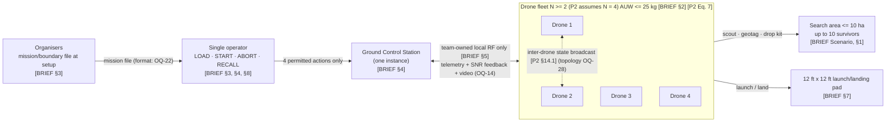

**Actors and their limits:**
- **Organisers:** provide the mission file only at setup [BRIEF §3].
- **Setup crew:** at most 2 people for at most 300 s [BRIEF §3, §6].
- **Operator:** exactly 1, at the GCS. The only inputs are load mission file, start mission, safety abort and emergency recall [BRIEF §3, §4, §8]. Paper 2's GCS lists only three buttons [P2 §12.3.2]. Recall is added because the Brief requires it (OQ-16 covers what each button does).

---

## 3. Layered design

Four runtime layers plus a shared `common` layer. The layering rules are adapted from ADIAT:
- controllers do UI wiring only
- services hold logic and I/O
- helpers are cross-cutting only
- generated UI files are never hand-edited

[ADIAT-inspired: `ADIAT-standards` §2.1]

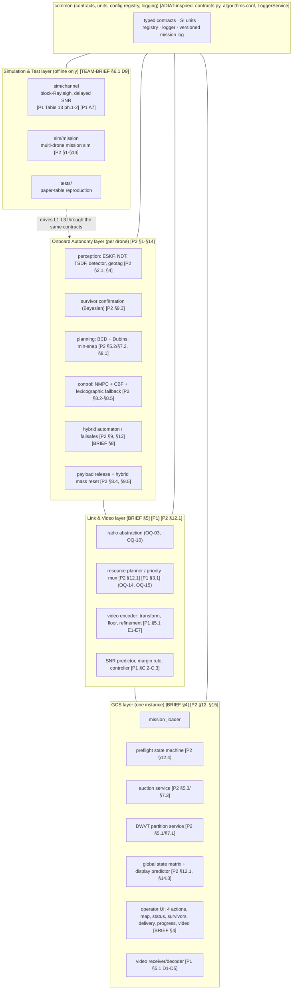

**Layer responsibilities:**

| Layer | Owns | Must not | Tags |
|---|---|---|---|
| Onboard Autonomy | state estimation, perception, confirmation, local planning, control, failsafes, payload | depend on the GCS for safety; any failsafe must work with the link down | [P2 §9.1 Eq. 247–249] [BRIEF §8] |
| Link & Video | radio access, resource split per GoP, telemetry framing, Paper 1 encoder side, SNR-report handling | make mission decisions | [P1 §5, §C] [P2 §12.1] |
| GCS | mission ingest, preflight, DWVT partition, auction, global state, display, Paper 1 decoder | offer any operator control beyond the 4 Brief actions | [BRIEF §3–§4] [P2 §12.3.2, §14.3] |
| Simulation & Test | channel and mission simulators, reproduction of the papers' tables, scenario files | be imported by runtime code | [TEAM-BRIEF §6.1 D9] [P1 Table 13] |
| common | contracts, units, registry, logging, persistence | contain feature workflows | [ADIAT-inspired: `ADIAT-standards` §2.1 helpers rule] |

**Where computation runs** (all per [P2] unless marked):
- **DWVT partition and survivor auction:** the GCS [P2 §5.3, §7.1 "continuously recalculated by the GCS"].
- **Geotag and confirmation:** onboard [P2 §4.3, §9.3]. The topology for multi-drone fusion is OQ-28.
- **Coverage paths (BCD):** computed initially at the GCS during setup [P2 §12.4 step 2]. After that they are re-planned onboard from the drone's assigned cell; the split is not stated explicitly, so it is held behind the `CoveragePlanner` interface.
- **NMPC, CBF, ESKF:** onboard, 50 Hz / 200 Hz [P2 §8.2, §2.1].

---

## 4. Component diagram

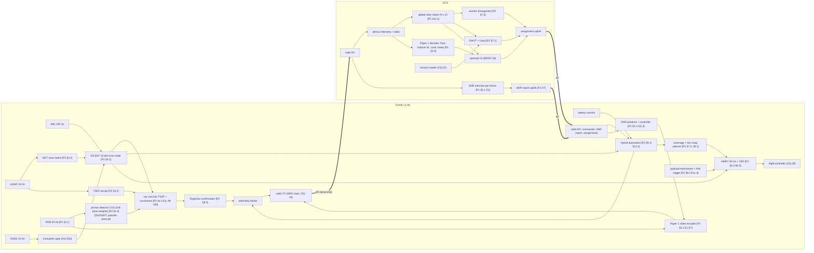

---

## 5. Deployment view

| Node | Hardware (status) | Software | Tags |
|---|---|---|---|
| Drone i | Airframe about 4.8 kg loaded (TARGET from P2); IMU, LiDAR, RGB, GNSS (listed); optical flow + barometer (OQ-19); companion computer "Jetson-class" (TARGET); flight controller (OQ-29); SDR-class radio (OQ-10); payload mechanism (OQ-01, OQ-20) | `onboard/*`, `swarm/confirmation`, `link/*` (drone side), `video/encoder*` | [P2 §2.1, §8.2, §8.4] |
| GCS | Laptop/PC (spec unknown); radio front end (OQ-03) | `gcs/*`, `swarm/dwvt`, `swarm/auction`, `link/*` (ground side), `video/decoder*` | [P2 §12] [BRIEF §4] |
| Dev / CI | Developer PC, offline | `sim/*`, `tests/*` | [TEAM-BRIEF §6.2] |

---

## 6. Key flows and sequences

### 6(a) Setup: 5-minute window [BRIEF §3, §6] [P2 §12.4]

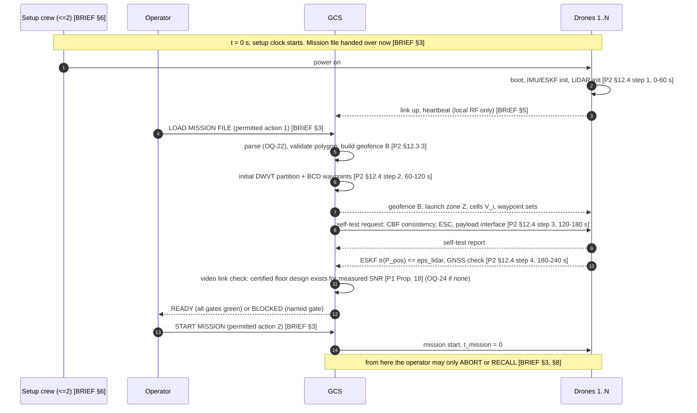

- The preflight gate list is a declarative table in `gcs/preflight`, so a missing gate fails the setup visibly instead of being skipped silently [ADIAT-inspired: failure isolation, errors that name the operation].
- The time slots are Paper 2's [P2 §12.4]. Whether they fit our hardware is OPEN (boot time unmeasured).

### 6(b) Search sweep [BRIEF §3, §4] [P2 §5, §7, §8]

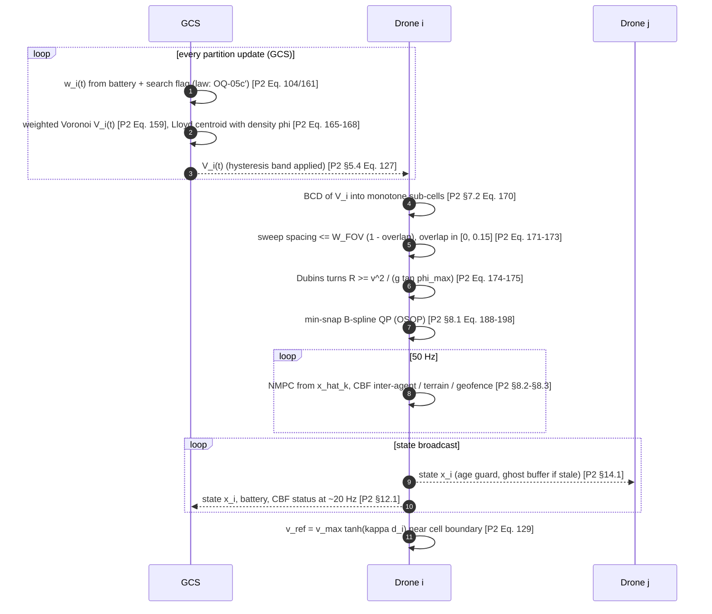

### 6(c) Detection → confirmation → geotag → auction → drop → return

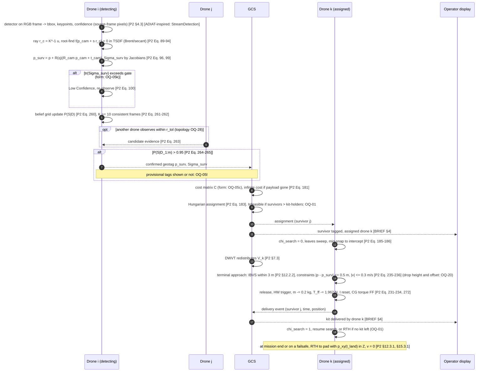

### 6(d) Video: GoP encode → channel → decode → display [P1 §5.1]

Summary only. The full design is in [VIDEO_SUBSYSTEM.md](VIDEO_SUBSYSTEM.md).

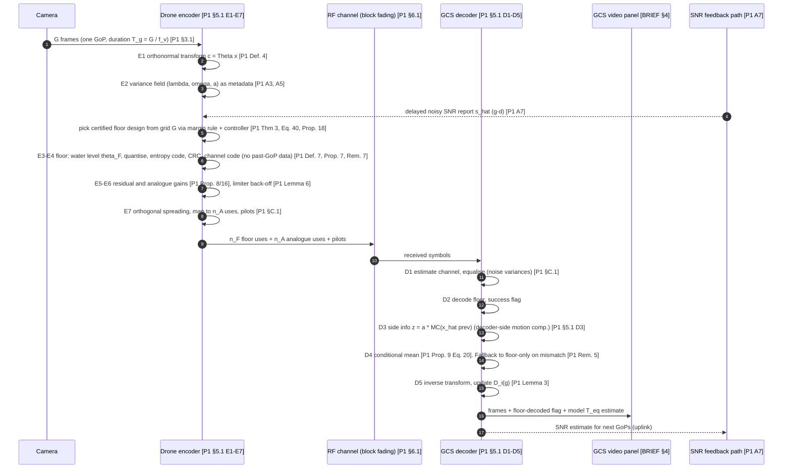

### 6(e) Failsafe paths [BRIEF §8] [P2 §9, §11.2, §13, §14]

All failsafes are **onboard-initiated**, or accepted onboard from the GCS. None needs the operator except abort and recall [BRIEF §3].

**(e1) Low battery → RTH** [BRIEF §8] [P2 §9.1 Eq. 245–246, §11.2.4]
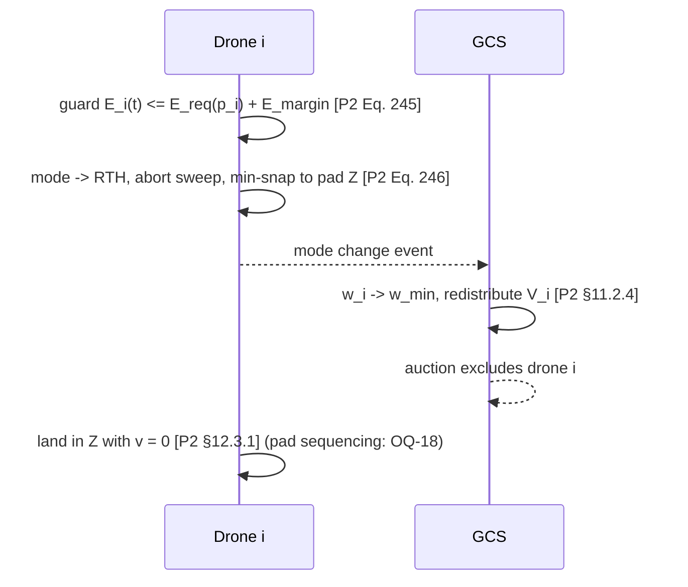

**(e2) Loss of command-and-control link → RTH** [BRIEF §8] [P2 §9.1 Eq. 247–249, §14.1]
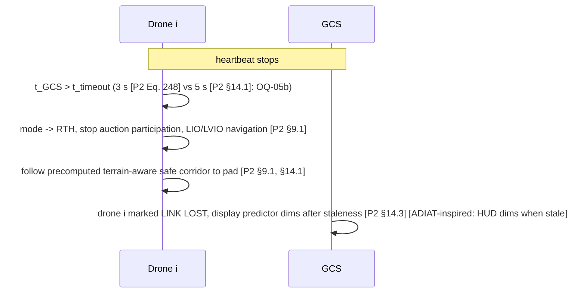
Note: how the "precomputed safe corridor" is computed, and when, is not specified in [P2]. It is an interface slot in `onboard/planning` (OQ-05 family).

**(e3) Geofence** [BRIEF §7, §8] [P2 §8.3 Eq. 224–225, §11.1.3, §12.3.3]
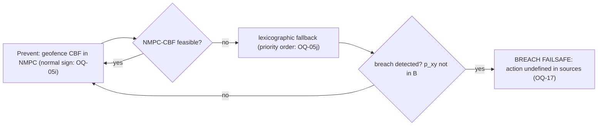

**(e4) Mission abort by the operator** [BRIEF §3, §8] [P2 §12.3.2]
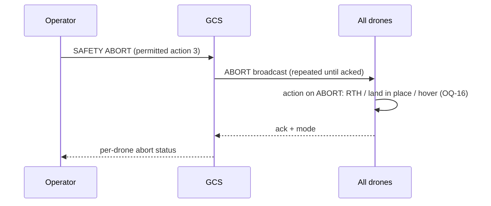

**(e5) Emergency recall by the operator** [BRIEF §3, §8]
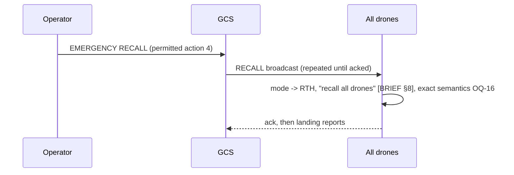

**(e6) Paper 2 degraded modes**, kept separate from the Brief's minimum set [P2 §9.2, §11.2, §13.2, §14]

| Guard | Source | Reaction | Open |
|---|---|---|---|
| tr(P_pos) > ε_lidar (0.5 m² representative) | [P2 §13.2.1] | gate LiDAR (R → ∞); reduce v_max; widen terrain margin | velocity law 05g; margin units 05e; fallback sensors OQ-19 |
| GNSS innovation fails gate | [P2 §9.2, §13.2.2] | reject GNSS; LIO/VIO; GCS freezes this drone's cell; auction suspended for it | gate form 05d |
| tr(P_pos) > ε_critical and GPS gated | [P2 §13.2.3] | EMERGENCY_HOVER; w_i → 0; resume when tr(P_pos) ≤ ε_lidar | mode-set membership 05a |
| neighbour state age > 200 ms | [P2 §14.1] | ghost buffer added to d_safe | formula 05h |
| NMPC-CBF infeasible | [P2 §8.5, §9.4, §14.2] | disturbance observer feedforward, then lexicographic relaxation, then safe state (hover / emergency land) | priority order 05j |
| payload jam / asymmetric drop | [P2 §3.4.3, §9.5] | CG torque feedforward; tracking relaxed before safety | — |

**Mode automaton.** Paper 2 gives two incompatible mode sets (OQ-05a). `onboard/automaton` is therefore built as a **table-driven** automaton: modes, guards, reset maps and priorities are loaded from a registered mode table [ADIAT-inspired: config-driven registry]. Both Paper 2 variants are encoded as candidate tables. Neither is the default until you choose.

---

## 7. Mission-level state (GCS view)

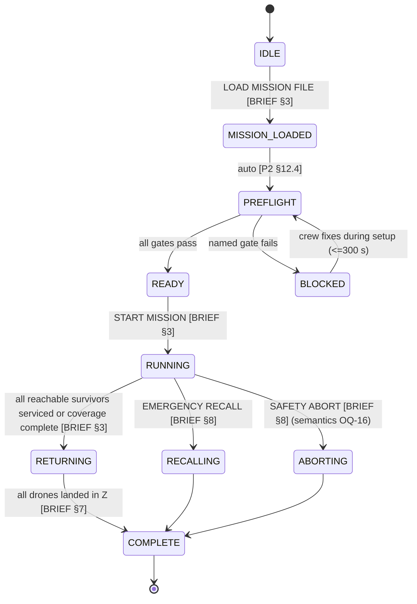
- The display shows mission elapsed time against the 30-minute cap [BRIEF §3], plus Paper 2's TARGET of 11 min (OQ-05f).
- The criterion for "coverage complete" (all cells swept once at the chosen overlap) is derived from [P2 §7.2]. Whether it should also require "no confirmed survivor unserviced" depends on OQ-01.

---

## 8. Cross-cutting design

| Concern | Decision | Tags |
|---|---|---|
| Contracts | One normalised result shape per stream type (`ProcessResult[T]`) with `error_message`. Adapters wrap any component that does not natively produce it. Orchestrators never crash on a bad item | [ADIAT-inspired: `streaming/contracts.py`, `adapters.py`, `StreamAnalyzeService.process_frame` try/except] |
| Pixel coordinates | Detections are always in **source-frame pixels**, top-left origin. Consumers never need to know the processing resolution | [ADIAT-inspired: `StreamDetection` docstring] |
| Registry | JSON registry maps component names to module, class and platforms (`onboard` / `gcs` / `sim`). No hard-coded routing tables. Unknown names fail loudly | [ADIAT-inspired: `algorithms.conf`, ADIAT-standards §2.3] |
| Units and frames | SI throughout; local inertial frame F_I (ENU assumed, pending OQ-22 for the geodetic datum); body frame F_B; quaternion body→inertial | [P2 §1.2 Eq. 8–9] |
| Time | Every message carries a source timestamp. GCS fuses by timestamp, with interpolation for display only | [P2 §12.1, §14.3] |
| Logging | One central logger service. Errors name the component, operation and input (drone id, GoP index, file). No bare `print` in runtime paths | [ADIAT-inspired: `LoggerService`, ADIAT-standards §2.4] |
| Persistence | Versioned, backward-compatible mission log: states, detections, tags, assignments, deliveries, video statistics. Used for replay in `sim/` | [ADIAT-inspired: versioned result files] [TEAM-BRIEF §6.1 D10] |
| Low-latency capture | Drop stale frames; frame-rate cap; one worker per pipeline; thread-safe config updates. Applies to the detector input and the video encoder input | [ADIAT-inspired: StreamAnalyze capture pattern] |
| Detection post-filters | Temporal voting, NMS and clustering are **only** what Paper 2's K-frame consistency and r_tol fusion require. Extra filters (aspect ratio, region masks) are not adopted unless you ask | [P2 Eq. 261–263] [ADIAT-inspired: post-filters] |
| Tiled detection | ADIAT's tiled ONNX inference with provider fallback is held as a detector **implementation option** behind the detector interface. Not required by Paper 2 | [ADIAT-inspired: `AIPersonDetectorService`] |
| Batch/offline processing | Worker pool with per-item timeout, failure isolation and fast cancel, for `sim/` sweeps and certificate sampling | [ADIAT-inspired: AnalyzeService] |
| Tests | Deterministic (fixed seeds), offline, no network. Lint gate. Traceability check fails if a requirement has no module or test (Phase 2) | [ADIAT-inspired: ADIAT-standards tests] [TEAM-BRIEF §8 Phase 2] |
| Licensing | No ADIAT source copied; patterns re-implemented clean-room. YOLOv8 weights licence flagged (OQ-08a) | [TEAM-BRIEF §4] |

---

## 9. Budgets

### 9.1 Weight [BRIEF §2] (OQ-07)
| Item | Per drone | Source | Status |
|---|---|---|---|
| All-up loaded mass | 4.8 kg | [P2 Eq. 227] | TARGET |
| Payload | 0.2 kg | [BRIEF §2] [P2 Eq. 229] | REQUIRED |
| Airframe, motors, ESCs, battery | — | none | OPEN |
| LiDAR, RGB, IMU, GNSS | — | [P2 §2.1] lists them, no mass | OPEN |
| Companion computer (Jetson-class) | — | [P2 §10.2] | OPEN |
| SDR-class radio for Paper 1 | — | inferred (OQ-10) | OPEN |
| Optical flow + barometer | — | [P2 §13.2] (OQ-19) | OPEN |
| **Fleet total (N = 4)** | **19.2 kg ≤ 25 kg** | arithmetic on [P2 Eq. 227] | TARGET; 5.8 kg margin, unallocated |

### 9.2 Time [BRIEF §3] [P2 §12.2.3]
- Hard cap: 30 min flight [BRIEF §3].
- Ideal coverage lower bound: T ≥ A / (N·W_FOV·v_sweep), with A = 100 000 m² [P2 §12.2.3]. Not evaluable (OQ-21).
- Paper 2's targets: ≤ 11 min design, 15 min objective (TARGET, OQ-05f).
- Setup: ≤ 300 s, using the Paper 2 slot plan [P2 §12.4] (TARGET).

### 9.3 Link
- Per drone, per GoP: n = (1 − δ)·W_i·T_g channel uses, split into pilots, floor n_F, refinement n_A, and telemetry (placement OQ-14) [P1 §3.1, §6.5].
- Telemetry demand [P2 §12.1]: state at 20 Hz per drone, map at 1 Hz. Packet sizes are not given in the sources, so the bit rate is OPEN.
- SNR feedback: at least one report per GoP per drone, uplink [P1 A7, Thm 3].

---

## 10. Language and tooling [TEAM-BRIEF §6.2]

| Part | Language | Why | Tags |
|---|---|---|---|
| Paper 1 maths, certificates, channel simulator, mission simulator, GCS logic, tests | **Python 3** with numpy/scipy (version: OQ-26) | Matches the paper's own reference approach (closed forms + Monte Carlo) and the standard scientific stack. Fast to verify against tables | [TEAM-BRIEF §6.2] [P1 §A] |
| NMPC 50 Hz with RK4, SQP-RTI | Generated C via acados/CasADi, called through a Python interface in simulation | P2 names CasADi/acados. Python alone cannot be assumed to meet 20 ms; the 8–12 ms claim is unvalidated | [P2 §8.2, §10.2] |
| ESKF 200 Hz IMU propagation, NDT, TSDF | C++ (or an existing compiled library) behind the `Estimator` / `TerrainMap` interfaces | Rate and point-cloud volume. Python reference used only in simulation | [P2 §2.1, §4.2] |
| Video baseband: spreading, mapping, pilots, limiter at W Msym/s; floor channel code | Compiled / SDR toolchain (choice tied to OQ-03, OQ-10, OQ-23) | Real-time sample rates in the MHz range. Python implements the *reference* maths only | [P1 §5.1 E7, §B.1, §C.1, §6.6] |
| Detector inference | ONNX / TensorRT on the companion computer behind the `PersonDetector` interface | Model is YOLOv8-pose [DATASET]; runtime kept swappable | [P2 §4.3] [ADIAT-inspired: provider fallback] |
| GCS UI | Python (desktop UI toolkit TBD in Phase 2; no web/cloud dependency) | Single local operator station | [BRIEF §4, §5] |

Rule: every real-time component sits behind a Protocol in `INTERFACES.md`, so the Python reference and the compiled implementation are interchangeable and tested against the same contract tests [TEAM-BRIEF §6.2].

---

## 11. What is proved, simulated, or only targeted (headline)

| Claim | Level | Assumptions / caveat | Tag |
|---|---|---|---|
| Floor holds: P[T_eq < T_min] ≤ ε_F for every GoP | PROVED (conditional) | A1–A6; i.i.d. Gaussian codebook; independent Rayleigh blocks; perfect CSI. Clipping and estimation error **not** in the certificate | [P1 Thm 2, §8] |
| Same, with delayed SNR feedback and any controller trajectory | PROVED (conditional) | adds A7–A8; A8 checked at one design point only | [P1 Thm 3–4, Prop. 18] |
| Floor needs L ≥ 4; floor share 52 / 30 / 22 / 17 % for L = 4 / 8 / 16 / 64 | SIMULATED | W = 5 MHz, T_g = 8/30 s, 10 dB, ε = 1e-3 | [P1 Cor. 6, Table 9] |
| Efficiency η ≈ 0.65–0.66; 3.3–3.5 dB below zero-latency H.264 | SIMULATED (one clip) | AWGN, oracle SNR, no fading, one noise draw | [P1 Table 11, 23] |
| Inter-agent / terrain / geofence safety | PROVED (conditional) | NMPC-CBF feasible; valid model and estimates | [P2 §6.3, §8.3, §11.1] |
| NMPC 8–12 ms on Jetson Orin NX | TARGET | "requires experimental validation" | [P2 §10.2] |
| Drop accuracy 0.3 m | TARGET | "design target unless independently demonstrated" | [P2 §12.2.2] |
| Mission ≤ 11 min | TARGET | ideal bound plus overheads | [P2 §12.2.3] |
| All Brief rules | REQUIRED | verified only by future tests | [BRIEF §1–§8] |
