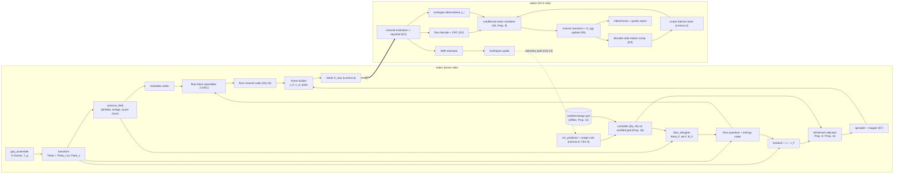
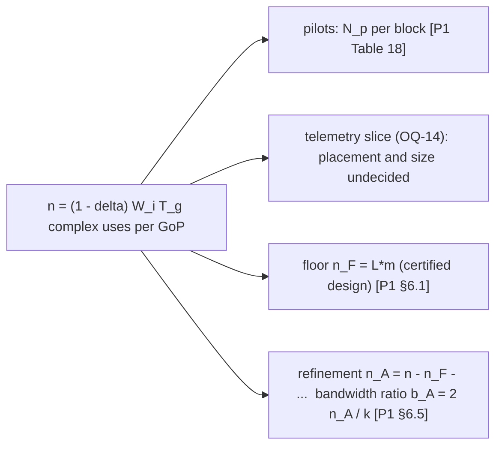

# Video Subsystem — Paper 1 design turned into modules

Status: **Phase 1 draft for review** · Deliverable D5 [USER-PROMPT §6.1] · Primary source: [P1] (`docs/sources/paper1_video_transmission.pdf`)

Tag conventions: [ARCHITECTURE.md §0](ARCHITECTURE.md#0-conventions).

> **Scope note.** This is the design for the GCS live-video link [BRIEF §4] using Paper 1's method, as D5 requires. Paper 2 instead specifies H.265 + ROI [P2 §12.1]. That conflict is **OQ-02** and is not resolved here. The GCS video panel reads frames through one `VideoSource` contract, so the decision does not change the GCS ([INTERFACES.md §7](INTERFACES.md#7-video-contracts)).

---

## 1. Requirement being solved

Paper 1 states the following problem [P1 §3.5 Problem 2]. For every GoP g (group of pictures):

| ID | Requirement | Form | Tag |
|---|---|---|---|
| V-F | Probabilistic **floor** | P[T_eq(g, h) ≥ T_min] ≥ 1 − ε, with T_min = 2 Mbps-equivalent | [P1 Eq. (F)] |
| V-R | **Ceiling** tracking | E[T_eq] ≥ η·E[min{T_max, C_n(h)/T_g}], with T_max = 10 Mbps | [P1 Eq. (R)] |
| V-B | Minimise channel-blind compression | min β_up = D_enc / D_tot | [P1 Eq. 8, Def. 3] |
| V-L | Latency | T_g + τ_proc ≤ L_max | [P1 Eq. (L)] |
| V-P | Peak power | revised to a hard limiter at A_max with optimal back-off | [P1 Eq. (P), §B.1] |
| V-C | Encoder complexity | ≤ κ_max operations per sample | [P1 Eq. (C)] |

T_eq is the **rate–distortion-equivalent throughput** on a state-independent reference scale: T_eq = R_g^ref(D_g(h)) / T_g [P1 Def. 6, Eq. 12]. It is computed from **model** distortions, using a Gaussian surrogate that upper-bounds the true information function [P1 §4.2, §8]. In this system T_eq is an *estimate* shown to the operator. It is not a measured bit rate.

**Converse (sanity bound):** T_eq ≤ (C_n(h) + S_g)/T_g [P1 Prop. 2, Prop. 5]. The floor is feasible only if the ε-outage capacity is at least T_min [P1 Cor. 1, Cor. 3].

---

## 2. Evidence status: read this first

What Paper 1 supports and what it does not. Carried verbatim in spirit from [P1 §7, §8, Table 12] [USER-PROMPT §0.5].

| Claim | Status in the paper | Our level |
|---|---|---|
| Floor holds whenever the floor block decodes | Supported analytically. Pilot: floor-only ≥ 31.6 dB in all 16 GoPs [P1 Table 22] | PROVED (conditional on A1–A6) |
| Floor-block outage ≤ ε_F | Certificate exists [P1 Thm 1, Prop. 11]. **Not exercised under fading** in the pilot | PROVED (conditional) / untested |
| Model predicts quality within about 0.4 dB | Supported on one clip [P1 §D.5 H2] | SIMULATED, one clip |
| Beats linear analogue by 8–10 dB at bandwidth ratio about 0.17 | Supported on one clip [P1 §D.5 H4] | SIMULATED, one clip |
| Beats a digital codec | **Not supported**: −3.3 to −3.5 dB vs zero-latency H.264, about −7 dB vs default preset [P1 Table 23] | contradicted on the pilot |
| Minimal channel-blind compression | **Not supported**: β_up = 0.78–0.84 at b ≈ 0.17; the converse forces the reduction [P1 §7.1, Table 11] | contradicted on the pilot |
| Robust to SNR uncertainty | **Untested**; floor infeasible at a 6 dB margin at 10 dB nominal [P1 Table 12] | OPEN |
| Encoder-complexity advantage | **Not measured** [P1 §8] | OPEN |
| Works on SDR hardware | **Untested** [P1 Table 13 phase 7] | OPEN |

**Pilot conditions** [P1 §D.2, §D.6]:
- one previously compressed animated clip, 640×352, 25 fps, 128 frames, 16 GoPs of G = 8
- AWGN only, with no fading
- oracle SNR
- one noise draw
- encoder statistics computed from the source (oracle)
- zero-motion side information

**Structural costs measured** [P1 §7.3, Table 22]:
- floor block = 1.90× the credited payload (max 3.13×)
- metadata = 36,360 bits per GoP, about 12 % of the floor block
- efficiency η ≈ 0.65–0.66, so the 10 Mbps ceiling needs about 15 Mbps-equivalent capacity [P1 §7.1]

**When the paper says a digital codec should still win** [P1 §7.3]: SNR known to within a few dB; long GoPs and B-frames allowed; bandwidth ratio well below 1; low-entropy or pre-compressed source; no encoder-complexity limit. Whether our link sits in that regime is OQ-03 / RISK-V02.

**Reference code.** `floorlab.py`, `evallab.py`, `runeval.py` and `runh264.py` are named in [P1 §A, §E] but are **not available to us**. Everything here is re-derived from the equations and checked against published tables (§11) [USER-PROMPT §2.4].

---

## 3. Hard prerequisites the design must expose

These are **preflight gates and runtime monitors**, not tuning knobs.

| # | Prerequisite | Number from the paper | How the system exposes it | Tag |
|---|---|---|---|---|
| P-1 | **Fading diversity** within a GoP: L ≥ 4 independent blocks | L ≤ 2 infeasible. Floor share 52 / 30 / 22 / 17 % at L = 4 / 8 / 16 / 64 (W = 5 MHz, T_g = 8/30 s, 10 dB, ε = 1e-3). A static flat link gives none | `CertifiedFloorDesign.L` is a required field. Preflight refuses a design whose L is not supported by the measured channel (OQ-03) | [P1 Cor. 6, Table 9, §6.4] |
| P-2 | **Timely SNR feedback** | Margin 3.17 / 6.07 / 7.57 / 9.22 / 10.53 / 11.16 dB for delay d = 0 / 1 / 2 / 4 / 8 GoPs / none (illustrative parameters). No feedback ⇒ infeasible at 10 dB nominal. "A structural requirement" | `SnrReport` uplink every GoP; delay d measured and displayed; preflight checks report freshness | [P1 Thm 3, Table 19, §C.2] |
| P-3 | **GoP length vs overhead** | Dispersion overhead ∝ G^−1/2 (e.g. 1.34 % at G = 1 → 0.47 % at G = 8, 10 dB, ε = 1e-3, i.i.d.); longer G adds latency | G is a single configuration value, traded against L_max (OQ-12, OQ-13) | [P1 Prop. 12 Eq. 27, Table 7] |
| P-4 | **No segmentation of the floor** unless forced | K = 64 segments: 4.95 % vs 0.47 % monolithic | Floor code is one long block or rateless (OQ-23). Segmentation is a logged deviation | [P1 Prop. 13, §6.6] |
| P-5 | **Pilot overhead** | e.g. m = 100 at 10 dB → 6 pilots (6 %); see Table 18 | `PilotPlan` per fading block | [P1 §C.1 Eq. 35, Table 18] |
| P-6 | **Peak power by limiter, not PAPR bound** | Optimal back-off 4.4 dB at 20 dB peak SNR instead of about 11.4 dB | One limiter at A_max shared by both layers | [P1 Lemma 6, Table 15, §B.1] |
| P-7 | **Certificate gap** | The floor certificate does **not yet** include clipping or channel-estimation error | Shown as an evidence caveat on the GCS; Phase 3 extends the sampler only if you approve | [P1 §B.1, §C.1, §8] |
| P-8 | **Violation-rate arithmetic** | Mean interval T_g/ε_F: 26.7 s @ 1e-2, 267 s @ 1e-3, 2,667 s @ 1e-4 (T_g = 8/30 s) | GCS counts floor failures against the ε_F budget | [P1 Cor. 7] |

---

## 4. Module decomposition

Each subsection below gives: purpose · equations · inputs and outputs · parameters · open points.

### 4.1 `gop_assembler`: GoP timing [P1 §3.1]
- Collects G frames with N = H·V·ρ samples per frame (ρ = 3/2 for 4:2:0). Source dimension per GoP is k = G·N. Duration T_g = G / f_v [P1 §3.1, Eq. 1].
- Applies the low-latency capture rules (drop stale frames; frame-rate cap) [ADIAT-inspired: capture pattern].
- **Parameters:** H, V, f_v, G are all **unknown for our camera** (OQ-12, OQ-21).

### 4.2 `transform` [P1 Def. 4, Lemma 2]
- Θ = Θ_t ⊗ Θ_s, with:
  - Θ_t: an orthonormal temporal transform (Haar or DCT-II)
  - Θ_s: an orthonormal 2-D block DCT
- c_g = Θ·x_g. Distortion is invariant under Θ [P1 Lemma 2].
- **No** motion search, no RD optimisation, no entropy-coder state at this stage [P1 §4.1].
- **Chunking** (the pilot's layout, used as the default *structure*, not sizes) [P1 §D.3, Table 21]: chunk = temporal index × 15 frequency zones (u + v) × spatial regions (4×4 luma, 2×2 chroma). 2,880 chunks at 640×352.
- **Open:** Haar vs DCT-II. The paper allows either and does not prefer one.

### 4.3 `variance_field` + metadata codec [P1 A3, A5, §D.3, Lemma 9]
- Per chunk j, from **source frames only** (open loop) [P1 §5.1 E2]:
  - stationary variance λ_j
  - loop gain a_j: regression on the temporal-DC prediction from the previous *original* last frame
  - innovation ω_j = λ_j(1 − a_j²)
- **Quantisation in the pilot:** λ, ω to 1 dB, a to 1/32. That gives 12 bits per chunk + 5 bits per temporal-DC chunk = 36,360 bits per GoP [P1 §D.3]. This is ≈ 12 % of the floor block.
- **Paper's target:** ≤ 3 % via a parametric variance field [P1 Table 13 ph. 4]. That is not designed by the paper, so it is not adopted here.
- Metadata travels **inside the protected floor block** [P1 A5, §5.1 E4].
- **Temporal mixing correction** for the DC band when side information comes from the previous GoP's last frame: σ̃_{0,j}(g) = ω_j + a_j²·G·Σ_t w_t²·D_{t,j}(g−1) [P1 Lemma 9 Eq. 41]. The decoder uses Eq. 41 in place of Eq. 9 for the temporal-DC band.

### 4.4 `floor_designer`: water level and payload [P1 Def. 5, Def. 7, Prop. 6, Eq. 16–17]
- **Water level:** solve R_g^ref(D(θ_F)) = T_min·T_g for θ_F, with:
  - R_g^ref(D) = Σᵢ ½·log₂⁺((ω_i + a_i²·θ)/θ)
  - D(θ) defined by Σᵢ min{θ, λ_i} = k·D
  - [P1 Eq. 12, E3]
- **Coded set:** F = {i : λ_i > θ_F}.
- **Payload:** B_F = R_g^intra(D_F) + |F|·Δ_q + B_meta = T_min·T_g + Δ_g(D_F) + |F|·Δ_q + B_meta [P1 Eq. 16–17], where:
  - Δ_q ≈ ½·log₂(πe/6) ≈ 0.2546 bit, the high-resolution limit. The paper treats this as a *measured* parameter [P1 §5.2].
  - Δ_g = Σ_{i: λ_i > θ} ½·log₂(λ_i/(ω_i + a_i²·θ)), the **firewall price** [P1 Prop. 6 Eq. 15]. It is 6 % / 22 % / 35 % / 49 % / 76 % of the intra rate at a = 0.5 / 0.8 / 0.9 / 0.95 / 0.99 [P1 Table 5].
- **Firewall rule:** the floor uses **no data from earlier GoPs**, so one outage cannot propagate [P1 §5.1 E4, Prop. 7, Rem. 5].

### 4.5 Floor quantiser and entropy coder [P1 §5.1 E4, §7.3]
- Uniform scalar quantisation of {c_{g,i}}_{i∈F}, with a static code model derived from the variance field. The pilot used a Laplacian-model code length [P1 Table 22].
- **Measured cost:** the floor block is 1.90× the credited payload. The paper's target is ≤ 1.3× via context-adaptive coding [P1 Table 13 ph. 5], which is not designed in the paper, so it is not adopted.
- Assumption A6: when decoded, the floor attains D_i ≤ min{θ_F, λ_i}. Any shortfall probability q is added to the outage budget [P1 §6.7 A6].

### 4.6 Floor channel code and certificate [P1 §6.1–§6.7, Thm 1–2, Prop. 11–13, Rem. 7–8]
- **Channel model** for certification: n_F = L·m uses, L blocks of m uses, block gain h_ℓ known at the receiver, codeword interleaved across all L blocks [P1 §6.1].
- **Information density** i_F (Eq. 22). Mean m·Σ log₂(1 + γ_ℓ) (Eq. 23). Variance m·Σ V_iid(γ_ℓ), with V_iid = 2γ/(1 + γ)·log₂²e (Eq. 24).
  - Use **V_iid**, not V, for i.i.d. ensembles. The V rule misses its target 6–15× [P1 Rem. 8, Table 8].
- **Certificate:** DT(B_F + 1; n_F, P_F) ≤ ε_F/2 ⇒ there exists a code with maximal block error ≤ ε_F [P1 Thm 1 Eq. 25].
  - DT is estimated by Monte Carlo, with a KL upper confidence bound p̄ at level δ (paper uses δ = 1e-6) [P1 Prop. 11].
  - The design is certified when p̄ ≤ ε_F/2.
- **Starting point of the search:** n_F^NA from the normal-approximation sizing [P1 Prop. 12 Eq. 26].
- **CRC** of r bits inside the payload converts undetected errors into detected ones, except with probability 2^−r, which is absorbed into ε_F [P1 Rem. 7].
- **Energy back-off** of about 3·n_F^−1/2 restores the power budget (< 0.04 dB for n_F > 10⁵) [P1 Rem. 7].
- **Code family:** long monolithic code vs rateless with stop feedback (same guarantee; mean floor share falls, e.g. 43.5 % → 14.6 % at L = 4 for an *ideal* rateless code) [P1 §6.6]. The choice is **OQ-23**.
- **End-to-end:** P[T_eq < T_min] ≤ ε_F, irrespective of side information, refinement and payload distribution [P1 Thm 2 Eq. 28], under A1–A6.

### 4.7 `refinement_allocator` [P1 §5.3, Prop. 8, Prop. 16, Rem. 6, Lemma 7]
- **Residual:** r_i = c_{g,i} − ĉ_i^F for i ∈ F, and r_i = c_{g,i} otherwise [P1 E5].
- **Notation** (the paper's; Phase 3 re-extraction keeps the Greek letters):
  - μ_i: side-information variance (Eq. 9)
  - κ_i: posterior after the floor
  - ϑ_i = min{λ_i, θ_F}: transmitted variance
  - ν_i: per-dimension noise
  - x_i = g_i²: gain squared
  - ξ: power multiplier
  - ζ: price of one active dimension
- **Posterior after the floor:** κ_i = (1/μ_i + [1/θ_F − 1/λ_i]⁺)⁻¹ ≤ ϑ_i [P1 Eq. 18].
- **Ideal channel knowledge** [P1 Prop. 8 Eq. 19]: minimise Σ D_i, with D_i = (1/κ_i + x_i/ν_i)⁻¹, subject to Σ ϑ_i x_i ≤ P.
  - Distortion: D_i = min{κ_i, √(ξ ν_i ϑ_i)}.
  - Power: P_i = ϑ_i x_i = [√(ν_i ϑ_i / ξ) − ν_i ϑ_i / κ_i]⁺.
  - Active exactly when κ_i² > ξ ν_i ϑ_i.
  - ξ is the unique root of Σ P_i(ξ) = P.
  - With no side information and no floor, this reduces to SoftCast-type allocation [P1 Cor. 5].
  - Implemented in `nidar/video/refinement/allocator.py`; checked by VT-04.
- **Channel-estimation error** (normalised error variance ε_i²): use [P1 Prop. 16 Eq. 36]. Effective precision is capped at 1/(ε_i²·σ_i), e.g. 16.1 dB at N_p = 4 pilots, 10 dB [P1 Eq. 37].
- **Clipping:** noise per dimension becomes (ν + σ_d²)/α² [P1 §B.1, after Eq. 30].
- **Active-set limit** |A| ≤ 2n_A: the Lagrangian saving per component is s(ξ) = (κ − √(ξνϑ))²/κ [P1 Lemma 7 Eq. 31]. Keep the components with the largest savings; the duality gap is at most the largest single saving [P1 Rem. 6].
  - The paper calls ζ "the saving of the marginal component" without saying which side of the cut that is.
  - The implementation uses the best *excluded* component. This is an interpretation, recorded here.
- **Open-loop gains:** gains come from the model recursion and the expected channel quality; no receiver feedback enters the gains [P1 Rem. 6]. Robustness: regret ≤ (1 + ε)² under multiplicative mismatch [P1 Prop. 15 Eq. 34]. Observed regret is much smaller [P1 Table 17].
- **Scene cut:** loss is bounded by the redundancy ratio ρ_max [P1 Cor. 8]. The floor guarantee is unaffected [P1 Cor. 9].

### 4.8 `limiter`: peak power [P1 §B.1, Lemma 6, Eq. 29–30, Table 15]
- Hard limiter y = x for |x| ≤ A, else A·x/|x|, with β = A²/σ².
- Bussgang gain α = 1 − e^−β + sqrt(πβ)/2·erfc(sqrt β). Distortion σ_d² = σ²(1 − e^−β − α²) [P1 Eq. 29].
- **Optimal back-off** maximises SNDR(β) [P1 Eq. 30] for a peak SNR γ_pk. Table 15: 0.75 / 2.85 / 4.41 / 5.63 / 6.63 dB at γ_pk = 10 / 15 / 20 / 25 / 30 dB.
- **One** A_max is shared by floor and refinement [P1 §B.1 "Revision of (P)"].
- **Open (P-7):** the floor certificate with clipping is not computed in the paper.

### 4.9 `spreader` / `mapper` [P1 §5.1 E7, Table 3]
- Analogue symbols are spread across packets by an **orthogonal matrix**, then mapped to n_A complex uses (two real dimensions per use) [P1 E7, §6.5].
- "Spreading transforms trade robustness against uniformity of loss" [P1 Table 3].
- **Open:** the matrix family (e.g. Hadamard) is not specified by the paper. It is a named parameter in `video/spreader`, **no default** (OQ-03 family).
- **Multicarrier** modulation is implied by the PAPR discussion (N_s samples, OFDM) [P1 §B.1]. The waveform belongs to the radio choice (OQ-10).

### 4.10 `pilots` / channel estimation [P1 §C.1, Eq. 35, Table 18]
- N_p pilots per fading block of m uses, same power as data. MMSE estimate with error variance σ_e² = 1/(1 + N_p·γ̄).
- Rate R(N_p) = (m − N_p)/m·E log₂(1 + γ̄|ĥ|²/(σ_e²γ̄ + 1)) [P1 Eq. 35]. The optimal N_p comes from Table 18. Overhead falls roughly as m^−1/2 (an observation, not a law).
- Feeds σ_e² into the refinement allocator [P1 Prop. 16] and the per-dimension noise ν_i [P1 §5.1 D1].

### 4.11 `snr_predictor` + margin rule [P1 §C.2, A7–A8, Lemma 8, Thm 3, Eq. 38–39, Table 19]
- **Model A7:** per-GoP mean SNR in dB is AR(1): s_g − s̄ = ρ(s_{g−1} − s̄) + w_g, with stationary std σ_s. Reports are noisy (σ_m) and delayed by d GoPs.
- **Prediction variance:** P_pred(d) = ρ^{2d}·P_f + σ_s²(1 − ρ^{2d}), where P_f is the steady state of the same scalar Kalman form as Prop. 3 [P1 Eq. 38].
- **Margin rule:** design SNR γ_d = ŝ_pred − z_ε·sqrt(P_pred(d)), with z_ε = Q^−1(ε). Floor failure ≤ ε + ε_core under A7–A8 [P1 Thm 3].
- **Budget split:** most of ε_F should go to ε (prediction), not ε_core [P1 §C.2 after Thm 3].
- **Cost of a margin:** about 12.3 / 8.7 / 6.4 / 4.9 % more floor channel uses per dB at 5 / 10 / 15 / 20 dB [P1 Eq. 39].
- **Caveat:** A8 (certificate monotone in SNR) is **not proved**; it was checked at one design point [P1 §C.2]. Table 19's ρ, σ_s and σ_m are illustrative and "must be measured for the target link" [P1 §C.2]. **Ours: unknown (OQ-03).**

### 4.12 `controller` on a certified grid [P1 §B.2, §C.3, Prop. 14, 17, 18, Thm 4, Eq. 32, 40]
- **Stationarity of the floor power:** (1 + γ_F)·ln(1 + γ_F) − γ_F = 2ξ/(μ·σ_c²), with μ, ξ the refinement multipliers [P1 Prop. 14 Eq. 32]. The root is unique. The paper finds it about 1–1.4 dB below the exhaustive optimum, on a flat objective [P1 §B.2, Table 16].
- **Damped iteration:** γ_F⁺ = (1 − β)·γ_F + β·φ(γ_F). Locally convergent iff 0 < β < 2/(1 + |s|). β = 1/(1 + |s|) ≈ 0.66 for s ≈ −0.52 on the synthetic model; it settles in two steps [P1 Eq. 40, Prop. 17].
- **Safety separation:** every iterate is rounded to the nearest **pre-certified** design (γ_F, n_F) not below the requested floor power. The floor guarantee then holds for **any** controller trajectory, convergent or not [P1 Prop. 18, Thm 4].
- **Grid generation:** offline, during development, by the Prop. 11 sampler, for each (L, margin, ε_core) of interest. Stored as a versioned artefact and loaded at setup [ADIAT-inspired: versioned result files].
- **System guarantee:** P[T_eq < T_min] ≤ ε + ε_core + ε_q for every GoP, with arbitrary controller trajectories and refinement mismatch [P1 Thm 4].

### 4.13 Decoder [P1 §5.1 D1–D5, §4.3, §5.4, Lemma 3, Prop. 3, Prop. 9]
| Step | Operation | Tag |
|---|---|---|
| D1 | Estimate the channel from pilots, equalise, set per-dimension noise ν_i | [P1 §C.1] |
| D2 | Decode the floor block; record the success flag (CRC) | [P1 Rem. 7] |
| D3 | Side information z_g = a·MC(x̂_{g−1}): **decoder-side** motion compensation, guided by the decoded floor's low-resolution reconstruction (hash-based MC at the receiver). No motion vectors sent. The pilot used zero-motion; the paper's target is ≥ 1 dB gain | [P1 §5.1 D3, Table 13 ph. 3] |
| D4 | Conditional mean ĉ_i = D_i [z_i/μ_i + (1/θ_F + g_i²/ν_i) ĉ_i^F + (g_i/ν_i) y_i], with 1/D_i = 1/κ_i + g_i²/ν_i. The 1/θ_F term is absent for i ∉ F. Implemented and Monte-Carlo checked (VT-03) | [P1 Prop. 9 Eq. 20] |
| D5 | Inverse transform; update D_i(g) (Kalman bank) | [P1 Lemma 3, Prop. 3] |

- **Steady state** per coefficient, for added precision η: D∞(η) = (−B + √(B² + 4η a² ω)) / (2η a²), with B = 1 + ηω − a² [P1 Prop. 3 Eq. 10]. Geometric convergence at rate ≤ a².
  - The code uses the algebraically equal form 2ω / (B + √(B² + 4η a² ω)). It avoids cancellation and covers a = 0.
- **Fallback:** if the decoder detects that analogue or side-information quality is mismatched, it uses the floor reconstruction only, which keeps the guarantee [P1 Rem. 5]. The detector and threshold for "mismatched" are **not specified** in the paper. They are a named parameter in `video/decoder`, flagged OPEN.
- **If the floor fails** (outage), the GoP is below T_min by definition. The decoder still outputs the best estimate from side information and the analogue layer, flagged `floor_ok = False`. The display behaviour is OQ-24.

### 4.14 Quality accounting (GCS) [P1 Def. 6, Prop. 10, Cor. 7]
Per GoP, the decoder publishes a `VideoQualityReport`:
- `floor_ok`
- model T_eq
- β_up (Prop. 10 Eq. 21)
- the design id in force
- the margin used
- the report delay d
- the running count of floor failures vs the ε_F budget (Cor. 7)

This lets the operator see evidence, not just pictures [BRIEF §4 "live video feed display"].

---

## 5. Resource split per GoP [P1 §3.1, §6.5, §B.2]

- **Energy:** n_F·P_F + E_A ≤ n·P̄. Boosting P_F shortens the floor but takes energy from refinement. The joint optimum is Prop. 14 / Eq. 32 [P1 §6.5, §B.2].
- **Reference points (illustrative)** [P1 Table 10], W = 5 MHz, 10 dB, AWGN: floor ≈ 11.6 %, b_A ≈ 0.213. At 1 MHz, 10 dB the floor takes 58.1 %. At 1 MHz, 5 dB it takes 97.8 %, leaving almost nothing for refinement.

---

## 6. GoP timing and latency [P1 Eq. (L), §3.1, Prop. 12]

- **Encoding latency floor:** a GoP cannot be sent before its last frame exists, so latency ≥ T_g + τ_proc (+ air time and decoding).
  - G = 8: T_g = 267 ms at 30 fps, 320 ms at 25 fps (the pilot) [P1 Table 21].
- **Trade-off:** longer G → lower dispersion overhead (∝ G^−1/2) and lower metadata per frame, but higher latency [P1 §6.3].
- **L_max is undefined** in every source (OQ-13). The video-latency number for the GCS is a configuration value with **no default**.

---

## 7. Sharing the link with telemetry: Paper 2 priority multiplexing [P2 §12.1, §15.1] [P1 §3.1]

**Paper 2's intent:** state (weight 10, about 20 Hz) > map (weight 5, about 1 Hz) > video (weight 1), with a video boost for a drone holding a candidate or doing a delivery [P2 §12.1].

**How this is carried over without picking a side:**
1. **Priority order is preserved.** In each GoP's `ResourcePlan`, the telemetry slice (state, then map) is reserved **before** video channel uses are allotted. This is Paper 2's ordering written in Paper 1's channel-use units [P2 §12.1] [P1 §3.1].
2. **Slice sizes are not decided.** Paper 2's LP is degenerate (OQ-15) and its packet sizes are unspecified, so the slice is a named parameter with no default.
3. **Floor safety is preserved regardless.** Telemetry reduces n (and so which certified design fits) but never alters a certified design's (n_F, P_F). If the reduced n can't hold any certified design, the GoP is flagged infeasible (OQ-24). This applies [P1 Prop. 18] directly.
4. **Same radio or separate radios** is OQ-14 (see IDEA-05, IDEA-06).
5. **Video boost** for a candidate-holding drone under the Paper 1 method is IDEA-04 (not adopted).

**SNR feedback uplink.** One `SnrReport` per GoP per drone travels on the telemetry path, GCS → drone. It has the same priority class as state, because without it the floor needs about 11 dB of margin [P1 Table 19] [P2 §12.1 state priority].

---

## 8. Multiple drones [OQ-09, OQ-11]

Paper 1 analyses a single link [P1 §3.1]. With N drones the system needs, per drone i:
- its own W_i
- its own encoder, decoder, SNR predictor and controller instance
- its own certified grid (W_i changes n)

How W is shared among drones is **not in any source** (OQ-11). The architecture keeps one `VideoLink` object per drone, so any sharing scheme fits without changing the codec.

---

## 9. Safety vs performance separation (why the floor survives everything else)

| Disturbance | Effect on floor guarantee | Tag |
|---|---|---|
| Wrong side information / scene cut | none | [P1 Prop. 7, Cor. 8–9] |
| Refinement-layer mismatch | none | [P1 Cor. 9, Thm 4] |
| Controller diverges | none, if restricted to the certified grid | [P1 Prop. 18] |
| SNR worse than predicted (within margin model) | bounded by ε + ε_core | [P1 Thm 3] |
| Clipping, channel-estimation error | **not covered** by the current certificate | [P1 §8] |
| Diversity L below the design's L | **not covered**: preflight gate P-1 | [P1 Cor. 6] |
| Quantiser shortfall | adds ε_q | [P1 A6, Thm 4] |

---

## 10. GCS presentation [BRIEF §4] [P2 §14.3]
- **One tile per drone feed** [ADIAT-inspired: per-feed tile]. Each tile shows:
  - the frame
  - a `FLOOR OK / FLOOR LOST` badge
  - model T_eq
  - the SNR report age d
  - the floor-failure counter vs budget
- The tile **dims when stale** [ADIAT-inspired: telemetry HUD dimming].
- The number of tiles shown at once is OQ-09.
- **No operator control** of video parameters: changing them would count as an input beyond the 4 permitted actions [BRIEF §3, §4].

---

## 11. Verification plan (Phase 3, only after approval) [USER-PROMPT §8 Phase 3]

> **Phase 4 status:** the full pipeline is built; end-to-end results are in [VIDEO_PIPELINE.md](VIDEO_PIPELINE.md).
>
> **Phase 3 status:** VT-01 to VT-19 are implemented. Results, including what did **not** reproduce, are in [REPRODUCTION_P1.md](REPRODUCTION_P1.md). VT-20 waits for L_max (OQ-13).

Each check re-implements the closed form from the PDF and compares with the **published** number. A mismatch is reported, never tuned away [USER-PROMPT §8].

| Test id | Reproduces | Inputs (from the paper) | Expected | Tag |
|---|---|---|---|---|
| VT-01 | Firewall price | ω/λ = 1 − a², λ/θ = 100, a ∈ {0.5, 0.8, 0.9, 0.95, 0.99} | intra 3.322; ref 3.117 / 2.598 / 2.154 / 1.707 / 0.785; price 0.205 / 0.724 / 1.168 / 1.615 / 2.537 bit | [P1 Table 5] |
| VT-02 | Kalman steady state | a = 0.9, ω = 0.19, π = 3 | D = 0.164001746899620 (closed form = iteration) | [P1 Prop. 3, Table 14] |
| VT-03 | Posterior variance | λ = 1, θ_F = 0.01, σ̃ = 0.2 | 0.009615384615 | [P1 Eq. 18, Table 14] |
| VT-04 | Allocation solver | 20 random instances vs constrained optimiser | max relative gap ~8.1e-11 | [P1 Prop. 8, Table 14] |
| VT-05 | Information-density sampler | m = 50, γ = 10, 4e5 draws (moments in nats) | mean ≈ 119.89, var ≈ 90.91 (paper's sample 119.90 / 90.78) | [P1 Lemma 4, Table 14] |
| VT-06 | Sizing overhead | B_F ∈ {66,667; 533,333}, ε ∈ {1e-3, 1e-5}, γ ∈ {5, 10, 20} dB | all 12 cells of Table 7 (i.i.d. and equal-energy) | [P1 Prop. 12, Table 7] |
| VT-07 | DT estimator + certificate | n_F = 1,000 / B_F = 3,300 and n_F = 154,897 / B_F = 533,333, γ = 10 dB | p̂ ≈ 5.22e-3, p̄ ≈ 5.61e-3; p̂ ≈ 5.10e-4 (Table 8 rows) | [P1 Thm 1, Prop. 11, Table 8] |
| VT-08 | Block-fading floor fraction | W = 5 MHz, T_g = 8/30 s, B_F = 533,333, 10 dB, ε = 1e-3, L ∈ {1, 2, 4, 8, 16, 64, 256} | ideal 27.74 / 1.409 / 0.435 / 0.271 / 0.212 / 0.167 / 0.151; certified 0.52 / 0.30 / 0.22 / 0.17 for L = 4 / 8 / 16 / 64 (OQ-30) | [P1 Table 9, Cor. 6] |
| VT-09 | AWGN floor share | grid W × γ | 97.8 / 58.1 / 30.1; 19.6 / 11.6 / 6.0; 4.9 / 2.9 / 1.5 % | [P1 Table 10] |
| VT-10 | Segmentation penalty | K = 1 vs 64, 10 dB, ε = 1e-3 | 0.47 % vs 4.95 % | [P1 Prop. 13] |
| VT-11 | Ideal rateless share | L = 4 / 16 / 64 | 43.5 → 14.6; 21.3 → 13.9; 16.7 → 13.8 % | [P1 §6.6] |
| VT-12 | Limiter closed form and optimal back-off | β ∈ {1, 2, 4, 8}; γ_pk ∈ {10…30} dB | α within 3e-4, σ_d² within 2e-5 of MC; Table 15 rows | [P1 Lemma 6, Table 15] |
| VT-13 | Floor power sweep and stationarity | synthetic λ_i = 1e3(1 + i/20)^−2, k = 2e4, a = 0.9, 10 dB | max T_eq ≈ 9.781 at 10.5 dB; Eq. 32 root ≈ 9.1 dB | [P1 Table 16, Prop. 14] |
| VT-14 | Mismatch regret | m = 60, ε ∈ {0.1, 0.25, 0.5, 1}, 300 draws | worst ≤ 1.0018 / 1.0064 / 1.0238 / 1.0622; bound 1.21 / 1.5625 / 2.25 / 4 | [P1 Prop. 15, Table 17] |
| VT-15 | Pilot optimisation | m ∈ {50, 100, 200, 500}, γ̄ ∈ {5, 10, 20} dB, 4e5 draws | Table 18 cells, e.g. m = 100 @ 10 dB → 6 pilots, 2.552 bit/use | [P1 Eq. 35, Table 18] |
| VT-16 | Allocation with estimation error | 10 random instances; ε² = 1e-6 vs Prop. 8 | gap ~4e-14; 3.025342 vs 3.025335 | [P1 Prop. 16] |
| VT-17 | Margin rule | T_g = 8/30 s, ρ = 0.875, σ_s = 3 dB, σ_m = 1 dB, ε = 1e-4 | sqrt P_pred 0.853 / 1.632 / 2.036 / 2.480 / 2.832 / 3.000 dB; margin 3.17 … 11.16 dB; +n_F columns | [P1 Lemma 8, Thm 3, Table 19] |
| VT-18 | Controller | synthetic model k = 8e3, β = 0.66, starts at 6 and 14 dB | both reach ≈ 9.41 dB in 2 steps; s ≈ −0.52 | [P1 Eq. 40, Prop. 17, Table 20] |
| VT-19 | Violation interval | T_g = 8/30 s | 26.7 s, 267 s, 2,667 s, 26,667 s | [P1 Cor. 7] |
| VT-20 | Latency budget | measured T_g + τ_proc per GoP | ≤ L_max (value pending OQ-13) | [P1 (L)] |
| VT-21 | H1 end to end | test video, AWGN 4–12 dB | full ≥ floor-only in every decoded GoP | [P1 §D.1 H1] |
| VT-22 | H2 end to end | same | model within 1 dB of measured (paper 0.4 dB on its clip) | [P1 §D.1 H2] |
| VT-23 | H5 vs zero-latency H.264 | testsrc2, 10 dB, ffmpeg/libx264 | H.264 + ideal code still wins (paper: −3.3…−3.5 dB) | [P1 §D.5 H5] |

**Channel simulator (D9)** [P1 Table 13 phases 1–2]:
- correlated Rayleigh blocks (L per GoP, correlation across GoPs)
- large-scale AR(1) SNR (A7) with delayed, noisy reports
- floor outage counting vs ε_F

The pilot's **video** experiments (Table 23) need the raw clip and H.264 runs. They are not part of Phase 3 unless you approve sourcing the clip (OQ for Phase 3).

---

## 12. Parameter register

"Paper value" is the value the paper used **in its own context**. "Ours" is the status for our link.

| Parameter | Symbol | Paper value (context) | Ours | Source |
|---|---|---|---|---|
| Floor rate | T_min | 2 Mbps-equivalent (scaled to 720p25) | 2 Mbps-eq (required by D5); scale reference OQ-12 | [P1 Problem 2, §D.2] |
| Ceiling | T_max | 10 Mbps-equivalent | same | [P1 Problem 2] |
| Floor outage | ε_F | 1e-3 in examples | **OQ-13** | [P1 Table 9] |
| Budget split | ε, ε_core, ε_q | — | **OQ-13** | [P1 Thm 4] |
| Latency budget | L_max | symbol only | **OQ-13** | [P1 (L)] |
| Frame format | H×V, ρ, b, f_v | 640×352, 4:2:0, 8-bit, 25 fps (pilot) | **OQ-12/21** | [P1 Table 21] |
| GoP length | G, T_g | 8; 8/30 s or 0.32 s | **OQ-12** | [P1 Tables 9, 21] |
| Temporal transform | Θ_t | Haar or DCT-II | **open** (either allowed) | [P1 Def. 4] |
| Chunk layout | — | 2,880 chunks (temporal × 15 zones × regions) | structure adopted; sizes follow frame format | [P1 Table 21] |
| Metadata quantisation | — | 1 dB; a to 1/32; 12 + 5 bits | adopted as starting point | [P1 §D.3] |
| Quantiser overhead | Δ_q | ≈ 0.2546 bit (hi-res) | to be measured | [P1 §5.2] |
| Symbol rate per drone | W_i | 5 MHz in examples | **OQ-03/11** | [P1 Table 9] |
| Overhead fraction | δ | — | **OQ-14** | [P1 §3.1] |
| Mean SNR | γ̄ | 5–20 dB in tables | **OQ-03** | [P1 Tables 9, 10, 18] |
| Fading blocks per GoP | L | ≥ 4 required | **OQ-03** (measure) | [P1 Cor. 6] |
| Block length | m | 50–500 in Table 18 | **OQ-03** | [P1 Table 18] |
| Pilots per block | N_p | Table 18 optimum | derived from m, γ̄ | [P1 Table 18] |
| SNR process | ρ, σ_s, σ_m, d | 0.875, 3 dB, 1 dB, 0–8 (illustrative) | **OQ-03** (measure) | [P1 Table 19] |
| Peak SNR / limiter | γ_pk, A_max | 10–30 dB | **OQ-10** | [P1 Table 15] |
| Controller damping | β | 0.66 (synthetic model) | recompute for our model | [P1 Prop. 17] |
| Certificate confidence | δ | 1e-6 | adopt | [P1 Table 8] |
| CRC length | r | symbol | **open** | [P1 Rem. 7] |
| Floor code family | — | long block or rateless | **OQ-23** | [P1 §6.6] |
| Spreading matrix | — | "orthogonal" | **open** | [P1 E7] |
| Fallback mismatch threshold | — | not specified | **open** | [P1 Rem. 5] |

---

## 13. Interfaces

Typed contracts for every arrow above are in [INTERFACES.md §6–§7](INTERFACES.md#6-link-contracts):
- `GopHeader`, `MetadataBlock`, `FloorBlock`, `AnalogueBlock`, `PilotPlan`
- `CertifiedFloorDesign`, `ResourcePlan`
- `SnrReport`, `VideoQualityReport`, `VideoFrame`
- `VideoEncoder`, `VideoDecoder`, `VideoSource` protocols
